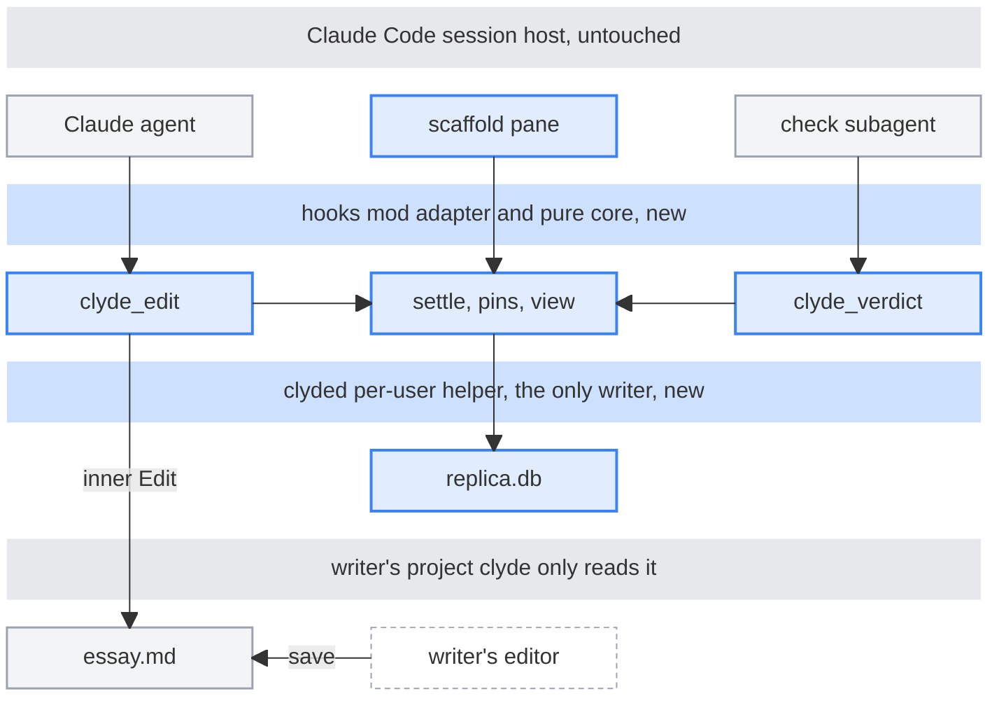
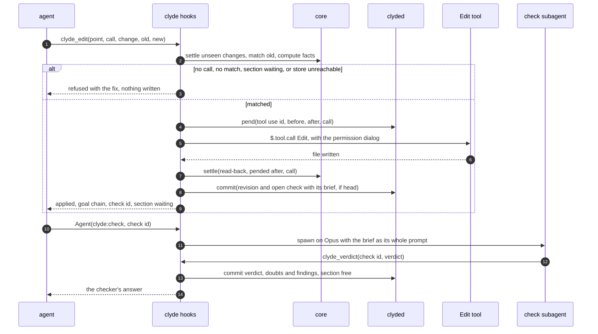

# Design

## Summary

Clyde keeps a scaffold of why a piece has its shape, makes every agent edit carry one call against it, and updates it with the edit. Clyde judges nothing: it blocks until the agent's Opus subagents record a check of each edit and the turn's lanes. Writers confirm the shape in a pane, and records stay in a local helper.

## L1 map



Blue is new and grey untouched: the agent edits through `clyde_edit`, the writer saves from the dashed editor, and the core commits every change to `clyded` on this machine. After each edit the agent spawns the check subagent, a step the map doesn't draw, and clyde blocks the next edit to that section until its `clyde_verdict` lands. Clyde also blocks the end of the turn until lane findings for every changed section land the same way, which the map doesn't draw either.

## What's new

- **`/plugin install clyde --marketplace gewenyu99/clyde`.** Installs the mod, skill and pane.
- **`/clyde init <file>`.** Tracks a manuscript and installs `clyded`.
- **`clyde_edit`.** Agent tool: point, call and edit in one.
- **`clyde_point`.** Shows a span's goals and commitments.
- **`clyde_scaffold`.** Scaffold changes with no prose edit.
- **`/clyde`.** Toggles the pane, and subcommands mirror every control.
- **`/clyde export` and `/clyde import`.** Move a piece's records to another machine.
- **`clyde:check`.** The Opus subagent the agent spawns after each edit and for each lane at turn end.
- **`clyde_verdict`.** Records a check subagent's verdict or findings.
- **`/clyde release`.** Lets a turn held for missing checks end.

## Core principles

Each principle names the writing method it draws on and why that method works. Source ids resolve in [sources.json](sources.json).

1. **Every unit serves the one above it.** Each section, paragraph and sentence has one job that serves the job above it, up to the main goal, so the agent can ask of any edit whether its span still does its job.

   Draws on discourse segment purposes (Grosz and Sidner), the pyramid principle (Minto), units of discourse (Gopen and Swan) and the goal network (Flower and Hayes). Grosz and Sidner model each segment's purpose as a contribution to the one above it, and Gopen and Swan show readers expect every unit to serve one function. Kellogg found writers who outlined first wrote better documents, since the outline eased attentional overload, and a goal per span hands the agent that outline at every level. Sources: grosz-sidner-1986, gopen-swan-1990, minto-pyramid, flower-hayes-1981, kellogg-1988.

2. **Point and call on every edit.** Before any edit, the agent points at the span and the job it does and calls out what a reader takes away after, in the same tool call as the edit. Only changes that leave the rendered text identical skip it, and no edit ever needs a second call. Clyde then blocks the next edit to that section until a fresh subagent's verdict on the diff is recorded, so clyde enforces the order and judges nothing.

   Draws on pointing and calling (shisa kanko), from Japanese rail, where crews point at each signal and call its state before they act. In a 1994 lab test it cut key-matching errors from 2.38 to 0.38 per 100 responses for about a third of a second, and after 100 routine signals 5 of 12 staff pressed the habitual key on the first red without it, none of 12 with it (Haga, Akatsuka and Shiroto, 1996). A plain enforced pause cut errors as much, and calling a rule aloud made switching to it faster (Shigemori et al. 2009, Shinohara et al. 2011). The habitual miss is why clyde calls on every edit, since an agent's sense of which edits matter is the habit that misses. The authors warn the practice turns into empty ritual when forced too often, so the call asks only what the agent already looks at (Ericsson and Simon), and an Opus subagent that sees only the diff and the scaffold judges it, since a model's account of its own edit isn't evidence (Turpin et al.). Sources: haga-akatsuka-shiroto-1996, shigemori-2009, shinohara-2011, ericsson-simon-1980, turpin-2023.

3. **The text can overrule the plan.** When an edit and the scaffold disagree, fixing the text and updating the goal are equal options, and the writer's own edits win by default.

   Draws on goal regeneration (Flower and Hayes), revision as discovery (Sommers) and reverse outlining. Writers change major goals based on what they learn while writing, and experienced writers revise to find the shape of their argument. Reverse outlining revises the thesis, the paragraphs or both, iComment's mismatches split between bad code and bad comments, and Wimsatt and Beardsley call the finished work the best evidence of intent, so either side can be wrong. Sources: flower-hayes-1981, sommers-1980, miami-howe-reverse-outlining, tan-icomment-2007, wimsatt-beardsley-1946.

4. **Commitments live in their own record.** Long-term choices like a term, a voice or a promise to the reader live in commitment records the whole piece is checked against, and local choices live on their span.

   Draws on the copyeditor's style sheet, the termbase, the series bible and conversational scorekeeping (Lewis). Copyeditors keep a style sheet to apply style consistently, and the Frasier writers kept a bible of everything established. Lifetime comes from which record a decision lives in, Lewis models these records as a score the text depends on and updates, and Vale shows term commitments compile into cheap deterministic checks. Sources: editors-canada-pes-2024, cmos-online-style-sheets, tbx-elements-reference, espenson-2008-frasier-bible, lewis-1979-scorekeeping, vale-styles.

5. **A change makes only its dependents suspect.** When a goal, span or commitment changes, the records that depended on it go suspect one level at a time, until someone re-checks them.

   Draws on suspect links (IBM DOORS) and truth maintenance (Doyle). DOORS marks a link suspect when either end changes, until a person clears it, and Doyle keeps a belief only while its justification holds. Drift between code and comments is the default state (Wen et al.), so every edit gets a blind check on Opus, but flags stay narrow, since developers who find one stale comment stop trusting the rest (Ibrahim et al.). So an edit raises a flag only when the blind check finds a confirmed span's job changed. Sources: ibm-link-validity, doyle-1979-tms, wen-2019, ibrahim-2012.

6. **Reasons are hypotheses with a source.** Every stored reason records who stated it, how and when, and the agent's edits are judged by the diff, through a check subagent that never sees the agent's explanation.

   Draws on verbal reports as data (Ericsson and Simon) and the W3C PROV model. Stated reasons often come from plausible theories (Nisbett and Wilson), model explanations rationalize biases they never mention (Turpin et al.), and LLM judges favor answers called refined and their own text (Ye et al. 2024, Panickssery et al. 2024), so the check reads blind and describes rather than grades. Reports captured during the work hold up, so a reason stated at the edit outranks one inferred later, and every record carries its source as PROV does. Sources: nisbett-wilson-1977, turpin-2023, ericsson-simon-1980, w3c-prov-dm-2013, https://arxiv.org/abs/2410.02736, https://arxiv.org/abs/2404.13076.

7. **The agent proposes, the writer confirms.** The agent drafts the scaffold and asks only when an edit deviates from it, and the writer accepts or rejects the changes that shape the piece. The line sits at section level, a choice open to question (R4).

   Draws on apprentice mode (Lee), incremental formalization (Shipman and Marshall) and SemanticCommit. Rationale systems foundered on capture overhead, so capture has to pay off now (Buckingham Shum et al.). Lee asks for a reason only when an action differs from what's expected, Schön finds reasons surface at surprise, Shipman and Marshall formalize only what the task needs, and SemanticCommit's writers resolved each flagged conflict themselves. Sources: buckingham-shum-2006, lee-1997, schon-1995, shipman-marshall-1999, vaithilingam-2025-semanticcommit.

8. **Draft first, check later.** In draft mode every edit still carries its call, no check opens, and the piece moves to revise once the writer confirms a main goal.

   Draws on freewriting (Elbow), structure from within (Diataxis) and reverse outlining. Editing while producing words damps voice, Dramatron's playwrights often learned what a play was about only at the end, and Diataxis lets structure grow from within. An Opus lane the agent runs then recovers the goals from the draft, so revise mode starts from what the text does. Sources: elbow-1973, mirowski-2022-dramatron, procida-diataxis-workflow, miami-howe-reverse-outlining.

9. **Unfinished ideas and inconsistencies are findings, not rewrites.** Lanes the agent runs on Opus subagents flag a setup with no payoff, a dropped idea, an open question, a term used two ways, numbers that disagree, contradicting claims and voice drift. Clyde holds the turn's end until they're recorded, and the writer decides.

   Draws on Chekhov's gun, the given-new contract (Clark and Haviland), the series bible and review lanes behind a verify gate. Chekhov cut any loaded rifle nobody means to fire, the given-new contract wants one antecedent per given term, and the Frasier bible kept facts from drifting. A code gate drops findings whose quote isn't in the text and one refute subagent a turn tries to knock down the rest, since one noisy flag costs trust in the rest. Sources: chekhov-1889-letter, clark-haviland-1977, espenson-2008-frasier-bible, ibrahim-2012.

## Map nodes

These are the L2 blocks, one per box in the L1 map, in map order. Everything after them is L3.

**Claude agent.** Edits a tracked manuscript only through `clyde_edit`, carrying its point, its call and the edit, and spawns a check subagent after each edit and for each lane at turn end. Built-in writes and Bash that would write a tracked file are denied, and every prompt says so.

**scaffold pane.** Shows what waits on the writer, then findings, then the outline, with open checks and any held turn in its header. A status line counts what waits when the pane isn't drawn, and it never edits prose.

**check subagent.** A `clyde:check` subagent on `claude-opus-5-5` whose whole prompt is the brief clyde built: the diff and the scaffold for an edit, or the changed sections for a lane. Its one tool is `clyde_verdict`.

**clyde_edit.** Matches the edit, journals a pending record in `clyded`, runs the host's Edit tool with its permission dialog, and hands the real before and after text to settle. It refuses only a missing call, an `old` that doesn't match once, a section still waiting on its check, or an outage, and once the write lands it answers `applied` with the check to run.

**settle, pins, view.** The pure core. It maps anchors, applies ops, re-pins, derives staleness, builds check briefs and the pane's view model, and commits each change to `clyded` as one revision.

**clyde_verdict.** Takes a verdict or findings only from the subagent clyde saw spawned for that check, runs the verify gate and commits the result. The section's next edit and the turn's end wait on it.

**replica.db.** All of clyde's state on this machine. `clyded` alone opens it, locked exclusive.

**essay.md.** The manuscript, plain Markdown with nothing added.

**writer's editor.** Any editor outside Claude Code. Its saves are the main edit path, and they map as `outside` until the writer claims them.

## Rulings

Vincent's rulings in [plan.md](plan.md) override this table, and any ruling here can be overturned by number.

| # | Ruling | Status |
|---|---|---|
| R1 | No scaffold record lives in the project, in git or in `CLAUDE_PLUGIN_DATA`. `clyded` is the only writer of clyde's state, and no hosted service holds a copy. | replaced |
| R2 | Every agent edit to a tracked manuscript goes through `clyde_edit`. Built-in writes and Bash that would write one are denied, and only a change a CommonMark parse proves invisible skips the call. | replaced |
| R3 | The Stop hook blocks the turn's end until every open check and the lanes over every changed section are recorded, and only the writer releases it. Findings never block, and agent items reach the next turn as "don't act unless the writer asks". | replaced |
| R4 | The writer confirms section and piece goals, the structure reason, commitments and exceptions. The agent and lanes change lower records unconfirmed, and only confirmed records are the yardstick. | kept, open |
| R5 | Writer confirmation is a pane button or a `/clyde` command typed in the composer or over Remote Control, never a quote. Acts typed during an agent tool call wait in the pane. | changed |
| R6 | Changes clyde didn't make are `outside` until the writer claims them. On the writer's edits the text wins, and on agent edits the confirmed scaffold is the yardstick. | unchanged |
| R7 | Moves, splits and merges land in one write. No multi-edit transactions. | unchanged |
| R8 | No locks and no retro calls. A change seen while an agent tool call or background command runs is the agent's with no call, a git move with none running is `git`, and the rest is `outside`. | replaced |
| R9 | The agent writes only through `clyde_edit` and `clyde_scaffold`, its check subagents only through `clyde_verdict`, and `clyded` serves only sessions bound to the Claude Code process. | replaced |
| R10 | Staleness is derived from pins on every read. The one stored verdict is a `doubt`, which only a writer act or a `holds` check clears. | changed |
| R11 | Merges resolve in the core over the revision DAG, with merge revisions every device mints alike. Same-field conflicts on confirmed records become writer picks. | replaced |
| R12 | Clyde makes no model call. Every judgment about meaning, semantics or style comes from the agent or its check subagents on `claude-opus-5-5`, read by model id, and an agent on another model has its meaning ops dropped. | replaced |
| R13 | One blind edit check per agent edit, run by a `clyde:check` subagent the agent spawns, and the next edit to that section waits for its verdict. Draft mode opens no check. | replaced |
| R14 | While a session runs, the mod stats tracked files every 2 s and around every agent tool call. | changed |
| R15 | Pause lets built-in writes through on one manuscript on this device, and ends with its session or after 8 hours. Paused edits are the agent's with no call. | replaced |
| R16 | The Opus outline lane builds the reverse outline at the switch to revise, with five coined or defined terms at most. | replaced |
| R17 | A scoped draft on one section keeps calls and opens no check, and closing it opens the outline lane there. | replaced |
| R18 | Guards fail closed before the write, each with a `.catch`, and once the write lands the answer is `applied`. | replaced |
| R19 | Every scaffold change is one revision in one `clyded` transaction that compares and swaps the head. Several agent edits can be pending on one file. | replaced |
| R20 | The call is three fields written before the edit: `point`, `call` and `change`. | replaced |
| R21 | `clyde_edit` refuses only a missing call, an `old` that doesn't match once, a section waiting on its verdict, or an outage, never for what the call says. | new |
| R22 | One edit check per agent edit, and 4 lane runs and 1 refute a turn at most, all in the agent's own session. Clyde sets no spend limit. | new |
| R23 | `clyded` is a Go helper, one per user per machine, alive from the first session to 10 minutes after the last. | new |
| R24 | Clyde runs only on the writer's machine. No hosted relay, no accounts and no service, and records live only in `clyded`'s replica. | replaced |
| R25 | Every revision names one exact text, and each working copy keeps a head per git ref. Changes map on top, never back to an old revision. | new |
| R26 | A file joins a piece by real path, then repo root commit plus path, then exact text, then quotes. A copy always asks. | new |
| R27 | Git is a read-only oracle with filters, textconv and external diffs off. Clyde never stages, commits, stashes or installs a hook. | new |
| R28 | Sessions bind by socket peer, the database is locked exclusive and every trusted row carries a MAC. | new |
| R29 | No collaborators in v1. They wait on a trigger in Defer with triggers. | replaced |
| R30 | `clyded` downloads only after the writer clicks Install and runs only at a listed SHA-256, never from PATH or `bin/`. | new |
| R31 | Text leaves the machine only to Anthropic. | changed |
| R32 | Nothing clyde writes lands in a git work tree, and a fixture test checks `git status --porcelain --ignored`. | new |
| R33 | A verdict counts only from the `clyde:check` subagent clyde saw spawned for that check, on `claude-opus-5-5`, with clyde's brief as its whole prompt. | new |

## Storage compared

Three shapes were stress-tested against S1 to S24, and all three pass N1, the hard gate.

- **Local daemon.** A 57 MB Bun binary owns SQLite on one machine, with manual packs between machines. It broke S3, S15 and S20.
- **Standalone app.** Clyde.app owns the store behind a Rust gateway and syncs through a folder provider. It broke S12, S15 and S20.
- **Helper plus relay.** A 15 MB Go helper owns SQLite, the core stays in the mod, and an encrypted relay carries revisions. It broke S11 and S20.

Scores run 1 to 5 from the stress verdicts.

| Criterion | Local daemon | Standalone app | Helper plus relay |
|---|---|---|---|
| No records in git | 5, pass | 4, pass | 4, pass |
| Gate latency, fail closed | 3 | 3 | 4 |
| Offline work | 4 | 5 | 4 |
| Surviving machine loss | 2 | 4 | 5 |
| Machines and collaborators | 1 | 3 | 4 |
| Simple to build | 4 | 1 | 2 |
| Install friction | 4 | 2 | 4 |
| Reach to other agents | 4 | 5 | 3 |
| Privacy | 5 | 5 | 4 |
| Forgery resistance | 2 | 3 | 2 |
| Fit with every ruling | 2 | 3 | 3 |
| Total | 36 | 38 | 39 |

The relay is dropped by ruling ("Local only, nothing hosted" in [plan.md](plan.md)), so the base is the Go helper alone. Its scores for machine loss and for machines and collaborators came from the relay, so they no longer hold. A new laptop needs an export, a second machine sees the first's edits as `git` changes, and collaborators wait. The helper keeps the faster gate, which never leaves the machine. At 15 MB it's a quarter of the daemon's size, and the app costs a second install and about 28,400 lines. The base takes the daemon's head rules and N1 test, and the app's exclusive locking, MACs, idempotent `pend` and visible writer acts.

Clyde switches shape when one of these fires.

- **To the app.** A writer without Claude Code needs to confirm, or a forged writer act shows up. The app joins as one more client of `clyded`.
- **Core into the helper.** `clyde-mcp`'s copy of the core drifts from the mod's, or settle overruns its bound on real pieces.

## The core and adapters

The core is pure TypeScript with every effect injected. It runs in the mod now, in a Bun-compiled `clyde-mcp` later, and in tests against a fake host. `clyded` holds no scaffold logic: it stores, materializes and MACs.

| Part | Core | Claude Code mod | `clyded`, Go | MCP adapter, second |
|---|---|---|---|---|
| Format | codecs, canonical JSON, loader rules | states from `clyded` | materializes revisions, MACs rows | same core |
| Edit and settle | match, CommonMark proof, diff facts, ops, anchors, settle | `clyde_edit`, guards with `.catch` | pending rows, one transaction per change | Codex `PreToolUse` and `PostToolUse` |
| Versions and identity | text ids, head rules, DAG merge, lookup order | git through the allowlist | commit map, file ids, scans | same allowlist |
| Lanes | triage, briefs, parsers, verify gate | `clyde:check`, the spawn hook, `clyde_verdict` and the Stop block | open checks and their checkers | checks queued for a Claude Code session |
| Pane | a view model as plain JSON | `$.ui.open`, `$.ui.status`, `ui.render` | the watch long poll | an MCP Apps widget |

No adapter calls a model, so the ports hold none. The core sees the world only through this type.

```ts
export type Ports = {
  fs: { read(p: string): Promise<string>, readBytes(p: string): Promise<Uint8Array>,
        exists(p: string): Promise<boolean>, list(d: string): Promise<string[]>,
        stat(p: string): Promise<{ mtimeMs: number, size: number } | null> }   // read only
  store: Store        // clyded: bootstrap, state, text, resolve, observe, pend, cancel, commit, act, kv, checks, watch
  git: ((args: [GitReadCmd, ...string[]], cwd: string) => Promise<{ code: number, stdout: string }>) | null
  tool: { write(input: EditInput): Promise<ToolOutcome>, read(path: string): Promise<ToolOutcome> }   // the host's own tools
  digest(algo: 'SHA-1' | 'SHA-256', bytes: Uint8Array): Promise<Uint8Array>
  budgetMs(): number                     // own time left in this hook, Infinity outside one
  now(): string
  id(): string
}
// Store.pend(p)   -> { ok: true } | { ok: false, why: 'down' | 'late' | 'format' }, idempotent by tool use id
// Store.commit(c) -> { ok: true, rev } | { ok: false, head }, a compare and swap on the working copy's head
```

`test/fake-store.ts` implements the store in memory, and integration tests run the real `clyded` in a temp home.

## Where records live

| Where | Holds | Only writer |
|---|---|---|
| `replica.db` | revisions, writer acts, diff-base texts, snapshots, working copies, pending records, settings like pause, checks, findings, activity | `clyded` |
| mod memory | the session's cap, in-flight tool use ids and `written` flags, open checks, cached states | the mod |
| `$.state` | the pane's view model, the tracked list, an offline pause and its edit journal | the mod |
| `$.store` | pane open or closed, and the store-less journal where `$.process` can't run | the mod |

Nothing goes in the project, in `.git`, in `CLAUDE_PLUGIN_DATA`, which uninstall deletes, or in the plugin root, which changes with every version (https://code.claude.com/docs/en/plugins/cli-reference.md#what-an-uninstall-deletes-and-keeps, https://code.claude.com/docs/en/plugins/loading.md).

```
macOS    <data> = ~/Library/Application Support/clyde/      <run> = <data>/run/
Linux    <data> = ${XDG_DATA_HOME:-~/.local/share}/clyde/    <run> = $XDG_RUNTIME_DIR/clyde/, else <data>/run/
Windows  <data> = %LOCALAPPDATA%\clyde\                     tier 2, deferred

<data>/bin/clyded-<version>        the helper, one file per version
<data>/replica.db, -wal            the replica, 0600
<data>/tracked.json                tracked paths, read by the mod while clyded is down
<data>/backups/replica-<date>.db   daily VACUUM INTO, 7 kept, plus one before each migration
<run>/ctl.sock, s-<8 hex>.sock     attach, and one socket per attached session
OS key store                       the MAC key
<data>/keys                        the same, 0600, only where no key store runs
```

The folders follow each platform's per-user data place (https://developer.apple.com/library/archive/documentation/FileManagement/Conceptual/FileSystemProgrammingGuide/MacOSXDirectories/MacOSXDirectories.html, https://specifications.freedesktop.org/basedir/latest/). `clyded` creates each 0700 and refuses a run folder it doesn't own or that isn't 0700. A socket path stays under 100 bytes (claude-code.d.ts:5384-5396) and never sits under `$TMPDIR` or `/tmp`, where sandboxed commands may write (https://code.claude.com/docs/en/sandboxing.md).

When `<data>` sits in a git work tree, `clyded` writes `<data>/.gitignore` holding `*` and the pane warns. It refuses a data folder under a sync root like `~/Dropbox`, since a copied live SQLite file corrupts (https://sqlite.org/howtocorrupt.html).

## The revision format

A revision is one immutable scaffold change that names the exact manuscript text it describes. Its id is `'r'` plus the first 32 hex characters of the SHA-256 of its canonical body, so two devices that make the same change make the same revision.

```ts
type RevBody = {
  v: 1                                   // format. A reader refuses a higher major version
  piece: string                          // 'p' + 26 random base32 characters
  parents: string[]                      // [] first, [head] usually, [ours, theirs] sorted for a merge
  text: { id: string, git?: string, bytes: number }   // git-blob SHA-1 of the raw bytes, git's id when filters differ
  kind: 'init' | 'settle' | 'outside' | 'claim' | 'decide' | 'lane' | 'merge' | 'git' | 'import' | 'fork' | 'hold'
  by: 'writer' | 'agent' | 'outside' | 'git' | 'hook' | `lane:${string}`
  act?: string                           // the writer act that authorizes it
  call?: { point: string, call: string, change: Change }   // verbatim. Absent on an agent change with no call
  client?: 'claude-code' | 'codex' | 'cursor'
  session?: string
  toolUse?: string
  agentId?: string
  at: string
  header?: { mode?: 'draft' | 'revise', drafting?: string[] }
  puts?: Record[]                        // full new versions of records whose fields changed
  ctx?: { [id: string]: { pre: string, suf: string, self: string } | null }
  base?: string                          // merges: the common ancestor used
}

type Kind = 'goal' | 'idea' | 'reason' | 'commitment'
type Level = 'piece' | 'section' | 'paragraph' | 'sentence' | 'word'
type Fn = 'claim' | 'reason' | 'evidence' | 'warrant' | 'concession' | 'response' | 'definition'
  | 'example' | 'background' | 'setup' | 'payoff' | 'transition' | 'summary' | 'question' | 'scene' | 'hook'

type Record = {
  id: string                    // kind letter, a hyphen, 6 random base32 characters: g-k3f9qa
  kind: Kind
  level: Level                  // ideas and commitments are 'piece'
  text: string                  // intent, idea, reason or commitment, in words. A working hypothesis
  fn?: Fn
  does?: string                 // observed function, written from the current text
  serves?: string               // absent only on the piece goal
  needs?: { id: string, rel: 'needs' | 'setup' | 'antecedent' | 'precedes' | 'supports' | 'answers' | 'echo' }[]
  anchor?: { q: string, end?: string }
  rule?: Rule                   // commitments only
  audience?: string             // piece goal only
  exigence?: string             // piece goal only
  pins?: { up?: string, kids?: string, needs?: { [id: string]: string }, order?: string }
  doubt?: { by: 'code' | 'lane:edit', at: string, was: string, now: string, why: string }
  standing: 'confirmed' | 'proposed'
  by: 'writer' | 'agent' | 'outside' | `lane:${string}`
  how: 'stated' | 'confirmed' | 'proposed' | 'inferred' | 'validated'
  said?: string                 // the call's call sentence
  at: string
  prev?: Omit<Record, 'prev'>   // last confirmed version while a proposal waits
  retired?: string              // tombstone: time and reason
  conflict?: Omit<Record, 'conflict'>   // the other side's version, for the writer to pick
}

type Rule =
  | { type: 'term', use?: string, not: string[], intro?: boolean, level: 'error' | 'warning' | 'suggestion' }
  | { type: 'promise' }         // needs a live dependent with rel 'setup' anchored after it
  | { type: 'fact' }
  | { type: 'voice', rank: number }
```

The state at a revision is its first parent's state with `header`, `puts` and `ctx` applied, so materializing needs no scaffold logic and runs in Go. Context and the `self` pin ride in revisions, so another machine re-anchors exactly.

A merge revision leaves out `session`, `toolUse`, `agentId` and `client` and takes `at` from its later parent. Two replicas merging the same heads mint one id, and a device that sees a remote merge of the parents it's merging adopts it.

Lifetime comes from the kind of record a choice lives in, never a flag on it. Span goals and anchored reasons live with their span, ideas while something uses them, and commitments from where they enter, so a term with `intro: true` can't be used before its anchor (lewis-1979-scorekeeping, editors-canada-pes-2024, clark-haviland-1977). Reasons stay sparse, since clause and word reasons are costly and unreliable even for trained analysts (carlson-2001).

The loader enforces what the type can't.

1. Exactly one live goal at level `piece`, and unique ids.
2. `serves` targets exist and form no cycle. A dangling `needs` id becomes a `sync` finding.
3. `rule` only on commitments, `audience` and `exigence` only on the piece goal, `doubt` only on anchored records.
4. A `confirmed` record at section level or above must be `by: writer`, from a revision whose `act` resolves to an act with a valid MAC. Any other loads as `proposed` with a `sync` finding.
5. Unknown keys round-trip unchanged.

## The replica

`clyded` opens `replica.db` alone, on one connection (`SetMaxOpenConns(1)`, pragmas in the DSN). Exclusive locking set before WAL means no shared-memory file, so every other opener gets `SQLITE_BUSY` (https://sqlite.org/wal.html).

```sql
PRAGMA locking_mode = EXCLUSIVE
PRAGMA journal_mode = WAL
PRAGMA synchronous = FULL

CREATE TABLE meta (k TEXT PRIMARY KEY, v TEXT NOT NULL, mac BLOB NOT NULL)   -- schema, device_id, hardware_id, key_check
CREATE TABLE piece (piece_id TEXT PRIMARY KEY, title TEXT, forked_from TEXT, mac BLOB NOT NULL)
CREATE TABLE rev (rev_id TEXT PRIMARY KEY, piece_id TEXT NOT NULL, parent1 TEXT, parent2 TEXT,
  text_id TEXT NOT NULL, kind TEXT NOT NULL, by TEXT NOT NULL, device_id TEXT NOT NULL,
  depth INTEGER NOT NULL, at INTEGER NOT NULL, body BLOB NOT NULL, mac BLOB NOT NULL)
CREATE TABLE text (text_id TEXT PRIMARY KEY, piece_id TEXT NOT NULL, git_id TEXT, bytes BLOB NOT NULL,
  pinned INTEGER NOT NULL, last_used INTEGER NOT NULL)
CREATE TABLE wc (wc_id TEXT PRIMARY KEY, piece_id TEXT NOT NULL, abs_path TEXT NOT NULL UNIQUE,
  file_id TEXT, repo_id TEXT, repo_root TEXT, repo_path TEXT, ref TEXT, git_head TEXT,
  seen_text TEXT NOT NULL, seen_mtime INTEGER, seen_size INTEGER, state TEXT NOT NULL, mac BLOB NOT NULL)
CREATE TABLE wc_head (wc_id TEXT NOT NULL, ref TEXT NOT NULL, rev_id TEXT NOT NULL, mac BLOB NOT NULL,
  PRIMARY KEY (wc_id, ref))                            -- a head per branch, detached commit or stash entry
CREATE TABLE commit_rev (piece_id TEXT NOT NULL, commit_id TEXT NOT NULL, rev_id TEXT NOT NULL,
  PRIMARY KEY (piece_id, commit_id))                   -- rebuilt from history and text ids
CREATE TABLE pending (pending_id TEXT PRIMARY KEY, wc_id TEXT NOT NULL, session_id TEXT NOT NULL,
  gen INTEGER NOT NULL, host_pid INTEGER NOT NULL, host_start INTEGER NOT NULL, agent_id TEXT,
  base_rev TEXT NOT NULL, before_id TEXT NOT NULL, after_id TEXT NOT NULL, region TEXT NOT NULL,
  call TEXT NOT NULL, deadline INTEGER NOT NULL, done_rev TEXT, mac BLOB NOT NULL)   -- keyed by tool use id
CREATE TABLE act (act_id TEXT PRIMARY KEY, session_id TEXT NOT NULL, kind TEXT NOT NULL,
  evidence TEXT NOT NULL, at INTEGER NOT NULL, mac BLOB NOT NULL)   -- pane, command
CREATE TABLE kv (piece_id TEXT NOT NULL, k TEXT NOT NULL, v TEXT NOT NULL, hlc TEXT NOT NULL,
  act_id TEXT, mac BLOB NOT NULL, PRIMARY KEY (piece_id, k))
CREATE TABLE check_run (id TEXT PRIMARY KEY, piece_id TEXT NOT NULL, rev_id TEXT NOT NULL, span TEXT NOT NULL,
  sections TEXT NOT NULL, lane TEXT NOT NULL, state TEXT NOT NULL, session_id TEXT NOT NULL, brief TEXT NOT NULL,
  checker TEXT, checker_model TEXT, reason TEXT, mac BLOB NOT NULL)   -- checker: the subagent's agentId
CREATE TABLE finding (piece_id TEXT NOT NULL, finding_id TEXT NOT NULL, rev_id TEXT NOT NULL,
  body TEXT NOT NULL, status TEXT NOT NULL, mac BLOB NOT NULL, PRIMARY KEY (piece_id, finding_id))
CREATE TABLE snap (rev_id TEXT PRIMARY KEY, body BLOB NOT NULL, mac BLOB NOT NULL)   -- heads and every 64th depth
CREATE TABLE activity (id INTEGER PRIMARY KEY, piece_id TEXT, at INTEGER NOT NULL, kind TEXT NOT NULL,
  body TEXT NOT NULL)                                  -- last 5,000 rows per piece
```

Every table but `text`, `commit_rev` and `activity` carries an HMAC-SHA-256 under the MAC key, checked on every read. `text` verifies by its id, `commit_rev` is rebuilt from history, and `meta` holds a key check value. Sessions live only in `clyded`'s memory. 5,000 revisions of 1 to 5 KB fill about 15 MB, an estimate slice 5 measures.

## Reaching clyded

The mod reaches `clyded` through `$.http.fetch` with `socketPath`, and each session binds to the Claude Code process itself.

1. **Attach.** At `session.start` the mod runs `clyded attach` through `$.process.run`, 10 s at most. When nothing listens on `ctl.sock`, attach starts `clyded serve`, which re-execs itself with `Setsid` and stdio on `/dev/null`, so `run` doesn't wait on it (claude-code.d.ts:3591-3594), and takes a `flock`.
2. **Check the host.** `clyded` reads the peer pid through `LOCAL_PEERPID` or `SO_PEERCRED` (https://pkg.go.dev/golang.org/x/sys/unix), requires it to run `clyded`, and takes its parent as the host. On macOS the host's code must meet Anthropic's designated requirement, team `Q6L2SF6YDW`. On Linux `/proc/<host>/exe` must sit under a Claude Code install folder, which is weaker.
3. **Answer.** Attach prints the session's own socket, "one per session, in a private directory" (claude-code.d.ts:5384-5396), and a 32-byte cap whose hash `clyded` keeps in memory. Attach checks that the process serving the socket is the hash-listed binary.
4. **Every request.** The cap rides in a header, never `auth`, so `CLAUDE_CODE_DISABLE_NONESSENTIAL_TRAFFIC` doesn't refuse it (claude-code.d.ts:3561-3565). `clyded` serves it only from the bound host with the same start time, so a child of the host can't use even a stolen cap.
5. **The cap.** Only in module memory, never in `$.env`, `$.state`, which any plugin reads (claude-code.d.ts:3466-3474), `$.store` or a file.

`clyded` answers these routes.

| Method and path | Does |
|---|---|
| `POST /v1/bootstrap` | working copies near the cwd, their heads, pending rows and states |
| `GET /v1/state/:rev`, `/v1/text/:piece/:id` | a materialized state, or a diff-base text from the replica or `git cat-file` |
| `POST /v1/resolve` | binds a path to a piece or asks, and returns a path's device and inode |
| `POST /v1/observe` | reports a disk change and returns the base and head rule |
| `POST /v1/pend`, `/v1/pend/cancel`, `/v1/commit` | journals an agent write, drops one the mod gave up on, commits a revision with a head compare and swap |
| `GET /v1/checks`, `POST /v1/checks/:id` | open checks and their briefs, and a check's checker or recorded result |
| `POST /v1/act`, `PUT /v1/kv/:piece/:key` | a writer act with its evidence, and settings that cite one |
| `GET /v1/watch?since=n` | a 25 s long poll for heads that moved elsewhere |

Each hook gets 10 s of its own time, and awaiting a `$` call doesn't count, except `$.clock.sleep` (claude-code.d.ts:5257-5293). So the mod never races a store call against a sleep. Each call is one fetch the host caps at 30 s, a `pend` carries a deadline 25 s out that `clyded` won't commit past, and backups and `quick_check` wait for 5 idle minutes. For a 20,000-word piece the estimate is 175 ms of store and settle time per `clyde_edit` plus the dialog, and release waits on a p95 store overhead of 50 ms, which slice 7 measures.

Slice 0 checks every host fact here, and each has a fallback.

- **The fetch peer isn't the host.** Bind by cap plus same uid, and doctor reports protection as `basic`.
- **The detached helper dies with its session.** The next request from any session re-attaches and starts another.
- **No `$.process` in Desktop or VS Code.** `clyde_edit` still takes its call and writes, the check still runs, and the call, hunks and verdict journal to `$.store` until a CLI session's `clyded` takes them.
- **Web-fetch policy refuses the socket's host.** `/clyde doctor` names the allowlist entry (claude-code.d.ts:3556-3560).

## Fail closed and recovery

Guards fail closed before the write (R18), and a store problem never costs the agent a second call.

- **Tracked set.** The mod denies the union of the `bootstrap` list in memory, its copy in `$.state`, and `<data>/tracked.json`, which `clyded` rewrites on every bind. If `replica.db` exists but `tracked.json` won't parse, every prose file counts as tracked until `clyded` answers.
- **Unreachable.** A failed or cut fetch, a protocol mismatch or a 5xx gets one re-attach and one retry. Then `clyde_edit` refuses with `DOC_BLOCKED`, and built-in edits and Bash naming a tracked file are denied, naming `/clyde doctor` and `/clyde pause`. The refusal writes and judges nothing, so the agent re-sends the same `clyde_edit` later, and each counts in the N2 metrics.
- **Offline pause.** `/clyde pause`, typed while the store is down, holds in `$.state`. Each built-in edit under it journals its tool use id, region and texts there, and lands as `agent, no call` when `clyded` returns.
- **The `.catch`.** Every guard registers `.catch(($, e, next) => next.called ? next(e) : { deny })`, so a throw or overrun before the write denies (claude-code.d.ts:4063-4080). `clyde_edit`'s own `.catch` reads its `written` flag first and, after the write, answers `applied, scaffold catching up, don't retry`.
- **No helper here.** Where `clyded` can't run, like a cloud session, the pane says so, and those edits map as `outside` back on the writer's machine.

Pending records carry an agent write across any crash.

1. **Pend.** Before the write, one transaction stores the call, the base revision, the before and after text ids, the region and the deadline, keyed by session, attach generation and tool use id. A repeated `pend` returns the same row, a late one is refused, and a mod that gave up sends `pend/cancel`.
2. **Write.** The host's Edit may wait on a permission dialog for minutes, and nothing expires meanwhile. Other edits to the same file pend and write beside it.
3. **Commit.** One transaction inserts the text and revision, swaps the head, marks the row done, and opens the edit check. A replay returns the same revision, and a lost swap re-settles on the new head.
4. **Finish.** The mod keeps its in-flight tool use ids in memory. Any later hook in the owning session finishes rows no longer in flight, as after Esc on the dialog or a reload: `new` in the region settles under the call, `old` still there drops the row, and anything else settles the region as the agent's and the rest as `outside`. A re-attach does the same for the old generation's rows.
5. **Sweep.** Another session finishes a row only when its host is gone, checked by `kill(pid, 0)` and start time.

Three failures get their own recovery.

- **`clyded` crashes.** SQLite replays the WAL, and start runs `PRAGMA quick_check` and checks every head's MAC. A failure restores from the newest backup and lists what was lost.
- **Every row fails its MAC.** The key check value tells a missing key from a wrong one. A missing key, as after copying the folder to a new Mac, asks for `/clyde import` of an export, whose bundle carries the MAC key, or `/clyde reseal`, which demotes every writer-level record to `proposed`. A wrong key is tampering.
- **Migrations.** A newer helper backs up with `VACUUM INTO` first (https://www.sqlite.org/lang_vacuum.html), and a replica newer than the helper refuses to open and names the plugin update.

## Document identity

A piece has a random id, and a working copy is one file on one device bound to it. Nothing marks the file, and the first step that answers wins (R26).

| Step | Key | Covers |
|---|---|---|
| 1 | the bound real path, case-folded on a case-insensitive volume | every edit, case aliases included |
| 2 | repo id plus repo path | a new clone, a new laptop, a second worktree |
| 3 | exact text id | a copy, a paste, an old branch |
| 4 | 60% or more of the latest head's anchor quotes occur in the file | a move with edits |

`$.fs.stat` keeps a hard link's own spelling and returns no file id (claude-code.d.ts:5150-5185), so a write to a prose path the guards don't know asks `resolve` for its device and inode first. A different file id never undoes a path match, since editors that save by rename get a new inode every save.

The repo id is the sorted root commits from `git rev-list --max-parents=0 HEAD`, which every clone and worktree shares, or the normalized `origin` URL in a shallow clone. The text id plays the part of Hypothesis's declared identifiers (https://web.hypothes.is/help/how-hypothesis-interacts-with-document-metadata/), while VS Code's path-keyed state orphans on a move (https://github.com/microsoft/vscode/blob/main/src/vs/platform/workspaces/node/workspaces.ts#L45-L80).

- **Auto-bind.** Only when exactly one piece matches at step 2 and the text equals or descends in git history from a revision's text. A worktree binds as a second working copy.
- **Moves (S18).** A missing path triggers git's rename detection (https://git-scm.com/docs/git-diff), then an exact text-id search over the repo's Markdown files, 2,000 at most. One exact hit rebinds with a note, a quote match or two hits ask, and no hit marks it `missing`.
- **Copies (S24).** An unbound file matching a piece bound elsewhere always asks: Same piece, New piece from this scaffold, or Ignore, since users rate an orphan above a weak reattach (brush-2000-robust-positioning).
- **First edit of a prose file.** The first edit of each prose file in a session asks `resolve` before it runs. A hit denies built-in writes until the writer answers, and `clyde_edit` applies into a `hold` revision that joins whichever piece the writer picks.
- **Init.** `/clyde init` checks for any piece with the same repo id and path first.

## Text versions and branches

A text id is the git blob SHA-1 of the raw bytes from `fs.readBytes`. It equals `git hash-object --no-filters` (https://git-scm.com/docs/git-hash-object), and git's own id for a committed file comes from `git rev-parse HEAD:<path>`, so no clean filter ever runs.

Each working copy keeps a head per ref: a branch, `detached@<commit>`, a stash entry, or `-` outside git (R25). When the disk text changes and clyde's own settle didn't make it, the first rule that applies wins.

1. **Same text as the head.** Nothing happens.
2. **A pending row.** The pending record finishes it.
3. **The ref changed.** The new ref's head is taken when its text matches the disk. Otherwise, when the disk equals the old ref's head text, as after `git switch -c` with uncommitted edits, the old head seeds the new ref, or merges with its head. Otherwise, when the disk equals HEAD's blob, the commit map seeds it from that blob's revision or its nearest ancestor. `git stash` files the head under its stash entry, and a pop takes it back.
4. **A merge landed.** `MERGE_HEAD`, `REBASE_HEAD` or `CHERRY_PICK_HEAD` exists, `git ls-files -u` lists the file, or `git rev-list --merges --ancestry-path <last HEAD>..HEAD -- <path>` names a merge commit. The merge path runs once per merge.
5. **HEAD moved on the same ref.** When the disk equals the new HEAD's blob, as after a pull or a reset, the change maps as `git` with the commit ids and authors. It gets the check and a Reviewed button, never "This was me".
6. **Anything else.** It maps from the head's text on top, as `agent, no call` when an agent tool call or background command ran across it, and `outside` otherwise. Commit authorship is never writer evidence.

The head never jumps back to an old revision because its text came back, so an editor undo or `git reset --hard` maps on top and later decisions survive.

- **Merge sides (S11).** Ours is the revision for the first parent's blob, theirs for the second's, and the base is their nearest common DAG ancestor or the revision for the `git merge-base` blob (https://git-scm.com/docs/git-merge-base).
- **Prose conflicts (S17).** While `git ls-files -u` lists the file or a full conflict marker triad sits in it, the working copy is `merging`. `clyde_edit` still works, but settle maps no anchors and the check waits.
- **Resolution.** The core merges records 3-way by id and field and maps each side's anchors to the merged text. Same-field conflicts on confirmed records become `conflict` fields.
- **Evil merges.** The core recomputes `git merge-file -p base ours theirs` (https://git-scm.com/docs/git-merge-file) and maps any difference by rule 6.
- **Rebase.** Ours is the new base's revision and theirs is `ORIG_HEAD`'s, mapped once when the rebase ends.

Every git call runs as `GIT_OPTIONAL_LOCKS=0 GIT_NO_LAZY_FETCH=1 git --no-pager -c core.fsmonitor=false`, with `--no-ext-diff --no-textconv` on `diff`, `log` and `show`, so a read never rewrites the index, fetches or runs a repo's driver (https://git-scm.com/docs/git). `status` skips paths `git check-attr filter` marks. The allowlist is `rev-parse`, `rev-list`, `ls-files`, `cat-file`, `hash-object --no-filters` without `-w`, `log`, `diff` without `--output`, `merge-base`, `merge-file -p`, `show`, `status`, `check-attr`, `for-each-ref` and `stash list` (R27).

## Machines and backups

- **Sessions on one machine.** One `clyded` serves them. Two sessions editing one file each keep their own pending row, and the later commit re-settles on the earlier.
- **Claude Code and Codex (S22).** In v1 Codex's edits are `outside` with no call, and Not me gets each the check. Release 2 gives Codex `clyde_edit` through `clyde-mcp`.
- **Two machines (S15).** Each machine keeps its own replica, and nothing passes between them on its own. A `git pull` that moves HEAD maps the other machine's edits as `git`, with the check and Reviewed, so calls and writer acts made there stay there.
- **Device identity.** The device id sits beside the hardware id, `IOPlatformUUID` or `/etc/machine-id`, and a mismatch at start, as after Migration Assistant, mints a new device.
- **Backups and export.** `clyded` keeps 7 daily `VACUUM INTO` copies. `/clyde export [file] [--md]` writes a passphrase-encrypted bundle carrying the MAC key, or a readable outline.
- **Another machine (S21).** `/clyde import` loads an export bundle there, and the piece binds by repo, path and text. On a machine where `clyded` has no record of a piece, the pane and the first prompt say clyde has no record of this file and offer import or track.

The daily backups sit on the same disk, so a dead laptop loses everything since its last export. A new laptop with no export can only track the file again, as a new scaffold.

## Keep the agent out of the store

Clyde defends against an agent taking shortcuts and against accidents. A same-user process with no sandbox can reach anything the user can, so every forgery takes several deliberate steps and the visible ones get flagged, as Codex calls its hooks a guardrail rather than a boundary (codex-hooks). The sandbox turns the guards into prevention (R28).

| Path the agent tries | What stops it |
|---|---|
| `curl --unix-socket` to `clyded` | the peer must be the bound host, so a cap is useless from a child. Sandboxed macOS commands can't open a socket `allowUnixSockets` doesn't list (https://code.claude.com/docs/en/settings-reference.md#sandbox-network-allowunixsockets) |
| `sqlite3 replica.db` | exclusive locking returns `SQLITE_BUSY`, and with `clyded` stopped a changed row in any trusted table fails its MAC |
| editing `$.store` or `tracked.json` | settings live in `clyded` behind MACs, and `tracked.json` only adds to the deny set |
| a clyde MCP write tool | `tool.check` refuses `clyde-mcp`'s tools by an explicit list of names, never by prefix (claude-code.d.ts:2750-2789) |
| running `clyded` by name | it isn't in `bin/`, and the plugin path variables aren't in Bash's environment (https://code.claude.com/docs/en/plugins/manifest-reference.md) |
| `tmux send-keys` or a nested `claude` typing `/clyde accept all` | Bash running `send-keys` or `osascript` keystrokes is denied, acts typed during an agent tool call or background command wait in the pane, and `clyded` refuses acts from a host whose environment has `CLAUDECODE` or `CLAUDE_CODE_CHILD_SESSION` |
| `clyde_verdict` from the main loop, another subagent or a fork | clyde takes a verdict only from the `agentId` it saw spawned for that check, and the spawn hook swaps in clyde's own brief (claude-code.d.ts:186-204, 257-430) |
| `clyde-mcp` posing as Codex | release 2 binds Codex's host by peer and, on macOS, code signature, and a Codex session's acts are never writer acts |
| `claude -p --plugin-dir` with its own mod | a `-p` turn's origin is `sdk`, so clyde makes no acts there. A mod the agent wrote can bind, which is outside the threat model |

A guard before every tool call denies calls whose input names `<data>`, `<run>` or `~/.claude/plugins/store`, in absolute, `~` or `$HOME` form. It catches mistakes and naive attempts, not obfuscation. A row that fails its MAC is quarantined, its piece's writer-level records from it drop to `proposed` with `prev` kept, and a tamper item shows.

The MAC key lives in the macOS Keychain or a Linux Secret Service, or a 0600 file under `<data>` where none runs, as on most WSL2. MACs prove tampering only while the key sits out of the agent's reach, as in a Keychain item whose ACL names `clyded`. `/clyde doctor` reports `strong` when the sandbox is on, `allowUnsandboxedCommands` is off, clyde's folders sit under `denyRead` and `denyWrite`, the key isn't a file, and on Linux the seccomp filter is confirmed (https://code.claude.com/docs/en/sandboxing.md). Otherwise it says `basic`, notes an agent could forge acts there, and prints the settings snippet.

## The anchors

Anchors are stand-off selectors on each record, with context in the revision and positions in a per-machine cache (w3c-web-annotation-2017, tei-p5-standoff). No inline IDs, since agents strip them when they rewrite (pandoc-bracketed-spans).

- **`q` and `end`.** An exact quote up to 300 characters, or the first and last ~60 characters of a longer span. A section's `q` is its heading line.
- **`pre` and `suf`.** 32 characters of context each side, recaptured in the revision's `ctx` at every settle.
- **Spans, not paragraphs.** Purposeful units don't line up with formatting, and spans may overlap (grosz-sidner-1986, swales-moves-via-iwatsuki-2020, moore-pollack-1992).
- **Boundaries.** Start maps with assoc +1 and end with assoc -1, so typing at an edge doesn't grow a span (peritext-2021, prosemirror-mapping).
- **Pin hashing.** The `self` pin hashes the span after collapsing whitespace, punctuation, Markdown, link syntax and case, and only the heading for a section (ibm-link-validity).

Resolution runs a cascade, and the first step that applies wins.

1. **Observed edit, exact.** `clyde_edit` holds the before and after text, so it maps every anchor through the steps (prosemirror-mapping).
2. **Base diff, exact.** Writer saves and outside changes diff the head's stored text against the disk. A deleted run of 20 or more characters that reappears counts as a move (git-blame-move-copy).
3. **Quote with context.** A hit counts only when its prefix or suffix matches or it sits within 10% of the position hint. Ties stay ambiguous.
4. **Fuzzy.** Hypothesis weights with maxErrors at min(256, length / 2) (hypothesis-match-quote), and numbers, names and committed terms must survive (brush-2000-robust-positioning). Never inside `tool.call`.
5. **Orphan.** Keep the quote and three guesses, never attach.

A score of 0.90 or more attaches. From 0.60 to 0.90 the record goes suspect with its best guess, and below 0.60 it orphans.

## Point and call

Every agent edit to a tracked manuscript carries one call inside the edit (R2, R20, R21). The agent points at the span and its job, calls out what a reader takes away after, and gives the edit, all in one `clyde_edit`. One tool rather than a call then an Edit gives one call per edit by construction, and the span can't disagree with the edit, since it comes from `old`.

1. **No prompt for the wrapper.** Clyde's `tool.check` allows `mcp__clyde__edit`, so the writer's permission applies to the write in step 5.
2. **Settle unseen changes.** The handler settles any disk change first, so a save mid-turn never shifts the agent's anchors.
3. **Match.** It finds `old` the way the Edit tool does, after line-ending and quote normalization, and widens it until it's unique.
4. **Facts.** Code computes the hunks, the touched records and their chain, term rules, `hollow` flags and op checks. Nothing here refuses.
5. **Journal, then write.** `pend` journals the call and expected after text. Then `$.tool.call({ tool: "Edit", file_path, old_string, new_string, replace_all })` runs through the permission check and its dialog (claude-code.d.ts:3100-3108), and clyde's Edit guard passes it since it matches a pending row. `whole` sends the current text as `old_string`, since Write refuses a file read only in part (https://code.claude.com/docs/en/tools-reference). A read-state refusal gets one inner Read and one retry, inside the same call.
6. **Settle.** It reads the file back and credits the agent with its own `old`-to-`new` change. Any other difference, from a save or a formatter hook, becomes an `outside` or `hook` revision on top, and a lost swap re-settles on the new head.
7. **Open the check.** The commit opens an edit check with its brief, and the sections the edit touched wait on its verdict.
8. **Answer.** About 600 tokens: `applied` with line numbers, the goal chain, confirmed commitments in the span, what went suspect, code notes like "declared wording, the diff changes 22% to 30%", the check's id with the Agent call that runs it, and earlier verdicts framed "for the writer, don't act unless asked" (R3).

Once the write lands, `applied` is the only answer, and a commit that can't finish leaves the row for the next drift check. Settle bounds its own time with a line diff first, a word diff only inside changed hunks, and one replaced region past 2,000 differences.

`clyde_edit` registers through `$.tool.register` as `edit`, so the model calls `mcp__clyde__edit` (claude-code.d.ts:3122-3135), with `isDeferred: false`. Agent-facing text always uses that name.

```json
{
  "type": "object",
  "properties": {
    "file":   { "type": "string", "description": "The tracked manuscript." },
    "point":  { "type": "string", "minLength": 8, "maxLength": 200,
                "description": "One sentence in your own words: what this span does for the piece now. For new text, what it is for." },
    "call":   { "type": "string", "minLength": 8, "maxLength": 200,
                "description": "One sentence: what a reader of this span takes away after the edit." },
    "change": { "enum": ["wording", "meaning", "function", "new", "delete", "split", "merge",
                         "move", "rename", "rewrite", "draft"] },
    "old":    { "type": "string", "description": "Exact text to replace, as Edit's old_string. Leave out with whole." },
    "new":    { "type": "string", "description": "The replacement, or the whole file with whole." },
    "all":    { "type": "boolean", "description": "Every occurrence of old. With change rename, clyde substitutes at word boundaries and keeps case." },
    "occurrence": { "type": "integer", "minimum": 1 },
    "whole":  { "type": "boolean", "description": "new replaces the whole file." },
    "ops":    { "type": "array", "items": { "type": "object" }, "description": "Scaffold ops, applied with the edit." }
  },
  "required": ["file", "point", "call", "change", "new"],
  "additionalProperties": false
}
```

The agent is told up front, so a deny is rare.

- **`prompt.compose`.** One `session` section under 400 tokens, byte-stable until a writer act changes it: "Tracked manuscripts: essays/why.md (revise). Change them only with mcp__clyde__edit: point, call, change, then the edit. Edit, Write and shell writes to them are refused. One mcp__clyde__edit per edit. It is never refused for what your call says. After each one, run Agent with subagent_type clyde:check and the check id it gives before you edit that section again." Then the main goal, audience, mode and confirmed commitments. A changed section rewrites the main thread's cache (claude-code.d.ts:4290-4294), so agent items and open checks ride `prompt.submit` context and tool results.
- **Read context.** A Read of a tracked manuscript adds the section goal, each paragraph's `fn` and `does`, dependents of the lines shown and the confirmed commitments in range, 400 tokens at most, with unconfirmed records marked as hypotheses.
- **The deny.** Edit, Write and NotebookEdit on a tracked manuscript are denied. Bash naming one passes only when a parse splits it into simple commands all on the read list, with no redirection, `tee` or output flag naming a tracked file, and no `$( )`, backticks, `eval`, `xargs` or `find -exec`. The list is `cat`, `head`, `tail`, `wc`, `grep`, `rg`, `diff`, `ls`, `stat`, `file`, `vale`, `markdownlint` without `--fix`, `aspell list`, converters like `pandoc` writing elsewhere, `cp` and `rsync` reading it, and git's `log`, `diff`, `show`, `blame`, `status`, `add`, `commit`, `push`, `restore --staged` and `stash list`. A typed `/clyde allow <command>` extends it. The deny reads "essays/why.md is tracked by clyde. Use mcp__clyde__edit with point, call and change, then old and new. Nothing was written."
- **Subagents.** One without the registered tools is told to hand the edit back to the main agent.

## Which edits skip the call

One kind skips it: a change a CommonMark parse proves leaves the rendered text identical. The before and after parses must match node for node, with text compared after collapsing whitespace, and HTML comments, link reference definitions and front matter count as content. That covers re-wrapped lines, trailing spaces, a final newline, CRLF to LF and a byte-order mark, and it catches a re-wrap that puts `1984.`, `#` or `---` at the start of a line.

Everything else takes a call: a typo, a comma, a capital, a link target, a heading level, a footnote. A comma can change what a sentence claims, and a capital turns a common noun into a name.

One more kind goes through with no call, since clyde can't stop it first: a change an agent tool call made outside `clyde_edit`, like a git move or a write a parse missed. It lands as `agent, no call` with the check, and counts against N2 beside `DOC_BLOCKED`.

That's almost none. LAMP's 8,035 expert edits were 74% replacements, 18% deletions and 8% insertions (chakrabarty-laban-wu-2025), and 98.6% of IteraTeR's labelled edits are fluency, clarity, coherence, style or meaning changes (du-2022-iterater).

## One call per edit

`clyde_edit` refuses an edit for five reasons and nothing else (R21).

| Code | When | Why it isn't a second call |
|---|---|---|
| `NO_CALL` | `point` or `call` is missing or under 8 characters | the attempt had no call |
| `NOT_FOUND` | `old` doesn't match, with the best guess and its line | Edit would refuse it too, and nothing was written |
| `NOT_UNIQUE` | `old` matches more than once, with every place | same |
| `CHECK_OPEN` | a hunk falls in a section whose last agent change still waits on its verdict, with the check id and the Agent call that runs it | nothing was written, and the edit sent again after the verdict carries one call |
| `DOC_BLOCKED` | the store is unreachable after a re-attach, the piece's format is newer than the helper, or the host refuses the write's read state after an inner Read | an outage, counted in the N2 metrics |

Another edit to the same file refuses one only inside a waiting section, and nothing the call or the edit says ever does. Each problem becomes a doubt, a finding or a proposal.

| Problem | What clyde does |
|---|---|
| `change` understates the diff | code notes it, and a label that alone disagrees with the check goes to Activity and the calibration count |
| the edit shifts or breaks a confirmed record or commitment | the check stores a `doubt` and raises a `calls` finding with the agent's call beside the check's takeaway |
| a missing op, like a function change with no `set` | an unconfirmed paragraph record takes the check's reading, and a confirmed one gets a doubt and a ready proposal |
| an agent off Opus sets `text`, `fn`, `does`, `serves` or `needs` | the op is dropped with a note, and the check writes those fields (R12) |
| a malformed op | dropped with a note, and `sync` raises a finding |
| an op only the writer can make | a proposal with `prev` kept, until a pane click or a typed command |
| a confirmed term rule broken | `rules` raises an error, and an `except` op becomes a proposed exception |

When the writer rejects the dialog or the tool errors, nothing settles and the pending row goes. After a rejection the result says "the writer rejected this edit, don't retry unless asked".

One `clyde_edit` makes one contiguous change, every occurrence with `all`, or the whole file with `whole`, and the one check returns a verdict per touched record. Over 40% changed counts as `rewrite`, and hunks over more than one section raise a `hollow` note unless the change is `rename`, `move`, `rewrite` or `draft`.

## How the call stays a real look

Haga et al. warn that pointing and calling turns into empty ritual when forced too often (haga-akatsuka-shiroto-1996). N2 forces it on almost every edit, so six things keep the look.

1. **It asks what the agent already looks at.** Reports of what's attended to hold up (ericsson-simon-1980), and writers revise for a span's job and reader (sommers-1980).
2. **It runs on every edit.** The habitual miss hides among routine signals, and "rose" to "fell" looks like wording to an agent.
3. **Nothing can be copied.** Content never refuses an edit, and the result arrives after the write.
4. **Code flags the gesture.** `hollow` flags a `point` repeated on a different span, a `call` repeated on a different diff, one that copies 80% of the record's text, or one that quotes the new text back.
5. **The judgment never rests on the call.** A model's account of its own work can rationalize (turpin-2023), so a hollow call loses the look but never the check.
6. **The goal comes back at every look.** Early instructions fade (li-2024-instruction-drift), and calling a rule re-activates it (shinohara-2011).

A `hollow` rate over 20%, or labels that agree with the check less as a session goes on, says the call's fields need to change.

## The edit check

One blind Opus judgment per agent edit, lane `edit`, which the agent runs in a subagent and clyde enforces (R13). Clyde builds the brief, binds the subagent and checks who records the verdict, and judges nothing itself.

- **Reads.** The brief alone: versions A and B of the touched paragraphs with hunks marked, the touched records as of the base revision, their chain and dependents, the confirmed commitments in scope and the diff facts. Unconfirmed `text` and `does` the agent wrote are marked unverified.
- **Never reads.** The agent's `point`, `call`, `change` or `ops`, the conversation, the files or any CLAUDE.md.
- **Why blind.** LLM judges in the CALM study leaned toward answers labelled as refined and rated their own outputs higher (https://arxiv.org/abs/2410.02736), and self-preference grows with self-recognition (https://arxiv.org/abs/2404.13076). So the check never sees the claim and describes rather than grades.
- **Judges.** Per touched record: what the span did and does now, its `fn`, and whether it still serves its parent and dependents, `holds`, `shifts` or `breaks` with a quote. Then the change class, what a reader takes away now, and any confirmed commitment it breaks.

The verdict is a check after the edit, never a second call. It comes from another loop, about the landed diff alone, so the agent's call stays the edit's only call.

1. **`clyde_edit` answers.** After `applied`, the result reads "check c-7f3a open, s2 waits on it. Run Agent with subagent_type clyde:check and prompt c-7f3a." The waiting sections are the ones whose spans hold the edit's hunks, by the anchor cascade.
2. **No brief tool.** Clyde builds the brief when the commit opens the check and keeps it on the check's row. The agent's Agent call names only the check id, so the agent never handles the brief and can't slant it.
3. **The spawn.** Clyde's `agent.spawn` hook sees the spawn's `prompt`, `subagentType` and `model`, can rewrite them, and gets `parentModel` (claude-code.d.ts:257-430). For `clyde:check` it finds the open check the prompt names, swaps the prompt for that check's brief, sets `model` to `claude-opus-5-5` and `background` to false, and stores the result's `agentId` and `model` on the check. It denies a spawn that names no open check, a check with a live checker, a fork, which carries the parent's context, and a resume.
4. **The checker.** At `session.start` clyde registers `clyde:check` with `$.agent.register`: clyde's fixed instructions as its whole system prompt, `tools: ["mcp__clyde__verdict"]`, `model: "claude-opus-5-5"`, `effort: "medium"` and `omitClaudeMd: true` (claude-code.d.ts:461-556, 3276-3302). A call to any other tool is refused, so the checker reads its brief and nothing else. `outline` and full checks spawn as `clyde:deep`, the same at `high`, which the hook picks by the check's lane.
5. **`clyde_verdict`.** The checker sends `{ check, result }`. Its `tool.call` carries `agentId`, the loop the call runs in, which is absent on the main loop (claude-code.d.ts:186-204). Clyde takes it only from the `agentId` stored on that open check, on `claude-opus-5-5`, and refuses the main loop and every other subagent.
6. **What clyde stores.** The verify gate runs, then one `lane` revision commits the verdict, its doubts, any `calls` finding and the `does` and `fn` of unconfirmed paragraph records. The check closes, its sections stop waiting, and the checker's answer returns as the Agent call's result.
7. **What blocks.** A `clyde_edit` with a hunk in a waiting section is refused `CHECK_OPEN` before anything runs: "s2 waits on check c-7f3a for your edit at line 41. Run Agent with subagent_type clyde:check and prompt c-7f3a, then send this edit again. Nothing was written." Edits to other sections go through, and the turn can't end while a check is open (Check lanes).

Every check, for an edit or a lane, lands under the same rules.

- **Verdicts.** Quotes must appear verbatim in version B, and the judged text hash must match the brief's. A verdict whose span a writer's save changed since still applies its doubts to the records it judged.
- **Failures.** A checker whose `turn.complete` arrives with no verdict leaves the check open with no checker (claude-code.d.ts:14196-14205), and the Agent result gets "check c-7f3a still open: the checker recorded no verdict". A checker the session forced onto another model can't record, and the pane says subagents can't reach Opus here. At `session.start` a check whose checker isn't in `$.agent.list()` loses it.
- **Mismatch.** `wording` and `meaning` map to their classes, `function`, `new` and `delete` to function, the other changes to structure, and `draft` to any. A doubt and a `calls` finding come only when the check reads `shifts` or `breaks` on a confirmed record, changes its `fn` or breaks a confirmed commitment. An unconfirmed paragraph record takes the check's `does` and `fn` directly.
- **Outside changes.** Not me gets them the same check, one per batch, and claimed writer edits get `gist` (R6). These open with no section waiting, and the next turn's end waits on them like any other check.

```ts
type EditVerdict = {
  edit: string
  judged: { textSha: string }
  class: 'wording' | 'meaning' | 'function' | 'structure'
  takeaway: string                       // what a reader takes from version B
  records: { id: string, did: string, does: string, fn: Fn, serves: 'holds' | 'shifts' | 'breaks',
             needs: { id: string, verdict: 'holds' | 'shifts' | 'breaks', q?: string }[], q: string }[]
  commitments: { id: string, q: string, why: string }[]   // confirmed ones it breaks
}
```

A lying or skipped call gets caught this way. No call is denied, a wrong span can't happen, and an understated class, a false call or a flip like "rose" to "fell" meets the blind check before that section's next edit, so a quick second edit can't hide the first.

## The edit loop

One agent edit, from the call to the verdict.



Solid arrows are calls and dotted arrows are returns. The agent can edit other sections before it spawns the checker, but not this one.

The writer's loop runs beside it.

1. **Save.** The writer saves in their own editor.
2. **Notice.** The 2 s stat timer, the next prompt, turn or `clyde_edit` sees the change.
3. **Map.** The core diffs the head's stored text against the disk and maps every anchor exactly.
4. **Hold.** The change is `outside` and waits, unchecked, on one "Was this you?".
5. **Answer.** This was me opens `gist`, so paragraph records follow the text and goal changes arrive as one Accept all. Not me opens the edit check. A typed `/clyde mine on` claims the session's saves made while no agent tool call or background command runs, with Not me on each batch.

## Attribute each change

Every change gets one author, and only the writer's own click makes it the writer's (R6).

| Seen | Author | What follows |
|---|---|---|
| `clyde_edit`, or a pending row a later hook or a sweep finishes | agent, under its call | settle maps it exactly, and the check reads it blind |
| any tracked-file change while an agent tool call runs, or a background command it started, until its task notification arrives (claude-code.d.ts:9288) | agent, no call | the check and a `calls` finding naming the call. Claiming it takes a second confirm that shows the call (R8) |
| built-in Edit or Write on a paused piece | agent, no call | the check (R15) |
| a git move with no agent command running | git | heads follow the ref, merges take the merge path, and a same-ref move gets the check and Reviewed |
| anything else: a save, a script, another agent, a session without clyde | outside | "Was this you?", then `gist` or the check |
| an outside change the writer claimed | writer | the text wins, and goal changes arrive as one Accept all |

## Propagate staleness

Staleness is derived from pins on every read, so it needs no queue and no merge rule (R10). A record is suspect whenever a pin stops matching, as DOORS link validity works (ibm-link-validity, doyle-1979-tms).

The one stored verdict is a `doubt`, written when the edit check finds a confirmed record shifted or broken. It rides in the record version. Only a writer act clears it, or a later check that reads `holds` against the record's last confirmed text, never an agent op or a change label.

```
status(r) =
  retired                                         if r.retired
  conflict                                        if r.conflict
  orphan or ambiguous                             if the anchor doesn't resolve
  suspect: doubted                                if r.doubt
  suspect: its text changed                       if the self pin differs from the hash of its span
  suspect: its parent changed                     if pins.up differs from vh(effective serves target)
  suspect: a child changed function               if pins.kids differs from kh(children)
  suspect: it needs X                             if a need target is retired or orphaned, or its pin differs
  suspect: the order changed                      if pins.order differs from the section order
  ok                                              otherwise

vh(r) = hash of kind, level, text, fn, serves, rule, retired
kh(r) = hash of the sorted (id, fn or does) pairs of r's children
```

Anchors and provenance stay out of `vh`, so moving or confirming a record doesn't stale its dependents. A proposed section or piece goal isn't effective until accepted (R4).

- **Down.** A changed goal stales its direct children only (egri-premise), and a child re-pinned as still serving stops the cascade.
- **Up.** A child whose `fn` changes stales its parent's `kids` pin, and `gist` recomputes the parent (kintsch-vandijk-1978, minto-pyramid). A verified "holds" re-pins a paragraph parent and only pre-fills a Confirm item at section level (carlson-2001). Anything else is a finding with revise text, update the goal, or both (miami-howe-reverse-outlining, sommers-1980, tan-icomment-2007).
- **Sideways.** A retired, orphaned or changed need target stales every record that needs it (kintsch-vandijk-1978, clark-haviland-1977).

Every lane verdict carries the `vh`, `kh` and text hash it judged, and applies only if all three still match, except the edit check's doubts. Section records pin only their heading, so edits inside a section never touch them (ibrahim-2012).

## Draft and revise

The mode lives in the revision header, and only the writer switches it.

- **Draft.** For discovery drafting, where editing while producing damps voice and the main goal may only show up at the end (elbow-1973, mirowski-2022-dramatron, procida-diataxis-workflow). Every edit carries its call with `change: draft`, no check opens and no section waits, term rules warn, and the header says "draft: checks off" with no count.
- **Revise.** Every check applies (kellogg-1988, sommers-1980). The switch is refused until the writer confirms a piece goal, since the main point has to be an explicit goal (bereiter-burtis-scardamalia-1988). The next turn's end then waits on the `outline` lane, which reads the whole text and proposes section goals, ideas, a structure reason and five coined terms at most, all `inferred`, as one batch (R16, shipman-marshall-1999). Draft edits stay unchecked, and the pane says so once.
- **Scoped draft.** In revise mode, `/clyde draft <heading>` or the pane opens one on a section (R17). Edits inside it carry calls and open no check, and `/clyde revise <heading>` closes it and opens `outline` there plus one check per touched record over the combined diff, for the next turn's end.

## Provenance and authority

Every record version carries `by`, `how`, `said`, `at` and `retired`, mapped onto PROV's attribution and generation (w3c-prov-dm-2013). `how` is the capture mode: `stated`, `confirmed`, `proposed`, `inferred` or `validated` (ericsson-simon-1980). Every reason is a hypothesis (nisbett-wilson-1977, turpin-2023), and the pane marks `proposed` and `inferred` records as unconfirmed.

| Change | Agent | Writer |
|---|---|---|
| paragraph, sentence and word records | directly, as `proposed`, and only through the check when the agent is off Opus | accept to confirm |
| section goals, the piece goal, the structure reason, commitments, exceptions | a proposal with `prev` kept | Accept, Reject or a typed command |
| re-pin a section or piece record | no, a `gist` "holds" only pre-fills Confirm | yes |
| switch mode, pick a side, pause, claim, release a held turn | no | pane or a typed command |

The mod reads each loop's model from `prompt.compose` (claude-code.d.ts:8618). On any model but `claude-opus-5-5`, split, merge and retire apply only where code proves them from the diff, and the header says "agent on <model>: the check subagent writes the scaffold".

No sentence in the chat confirms an op, since deciding what a sentence asks for is inference (R5). A writer-level op from the agent lands as a proposal with `prev` kept, and it takes effect only on Accept in the pane or a typed `/clyde accept`, from a `command.run` whose `origin.kind` is `composer` or `bridge`.

## Agent tools

All four register through `$.tool.register` as `point`, `edit`, `scaffold` and `verdict`, so the model sees `mcp__clyde__point`, `mcp__clyde__edit`, `mcp__clyde__scaffold` and `mcp__clyde__verdict`, and Claude Code needs no MCP server.

- **`clyde_point`.** Read-only. With a span: where it is, the goal chain, records inside it, commitments, dependents, open findings and the mode, 800 tokens at most. Without one: the reverse outline 40 paragraphs a page.
- **`clyde_edit`.** The call and the edit, per Point and call.
- **`clyde_scaffold`.** `{ file, ops, why }` for scaffold changes with no prose edit, like re-pointing a need. It changes no text, so it needs no call, and the check reads what it wrote as unverified.
- **`clyde_verdict`.** `{ check, result }`, taken only from the `clyde:check` loop bound to that check, per The edit check.

```ts
type Ref = string                // a record id, a heading line, or an exact quote inside the record's span

type Op =
  | { add: { alias?: string, kind: Kind, level: Level, text: string, fn?: Fn, does?: string,
             serves: Ref, needs?: { to: Ref, rel: string }[], anchor?: string | '@new' | null, rule?: Rule } }
  | { set: { ref: Ref, text?: string, fn?: Fn, does?: string, serves?: Ref,
             needs?: { to: Ref, rel: string }[], anchor?: string, rule?: Rule, audience?: string, exigence?: string } }
  | { retire: { ref: Ref, why: string } }
  | { split: { ref: Ref, at: string } }          // at: exact quote where the second part starts
  | { merge: { keep: Ref, drop: Ref[] } }       // keep's anchor widens over all, drop retires
  | { repin: { ref: Ref } }                     // paragraph level and lower only
  | { except: { commitment: Ref, at: string, why: string } }   // waits for the writer
```

Settle creates no record for new text, and one appears only when a dependency, a reason or the outline needs it (procida-diataxis-workflow). It auto-retires an unconfirmed record whose text vanished and orphans a confirmed one with a finding.

## The writer's checklist

`skills/clyde/SKILL.md` gives the agent the revise loop a call stands for.

1. **Reader.** Who reads this, and what do they hold by now (sommers-1980, bitzer-1968)?
2. **Point.** What does this span do for the piece? That sentence is `point`.
3. **Call.** What should a reader take away after the edit? That's `call`, since every unit carries one point (gopen-swan-1990).
4. **Orwell's questions.** What's the meaning, which words express it, can it be shorter, is anything needlessly ugly (orwell-1946)?
5. **Given, then new.** Open each sentence on what the reader has (clark-haviland-1977) and end on what should land (gopen-swan-1990).
6. **Commitments.** The terms, voice, promises and facts in range still hold, or the call carries an `except` (lewis-1979-scorekeeping, vale-styles).
7. **Ask first.** A finding that needs prose changed waits until the writer asks.

## Mod events

`hooks/hooks.json` declares only the module, and every hook registers a `.catch` that answers in its place.

| Event | Does | Time | Tokens added |
|---|---|---|---|
| `session.start` | attaches, bootstraps, finishes dead rows, runs drift, registers `clyde:check` and `clyde:deep`, clears checkers that are gone, starts the watch loop and the 2 s timer | 100 to 200 ms, 3 s cold | none |
| `prompt.submit` | runs drift, adds outside changes, agent items and open checks as context | 30 ms | 300 at most |
| `turn.start` | drift | same | none |
| `prompt.compose` | records each loop's model, adds the stable `session` section outside checker loops | 5 ms | 400 at most |
| `tool.check` | allows `mcp__clyde__edit` and `mcp__clyde__verdict`, refuses `clyde-mcp`'s tools by name | under 1 ms | none |
| `tool.call`, `clyde_edit` | the eight steps, or `CHECK_OPEN` | 175 ms plus the dialog | 600 |
| `agent.spawn`, `clyde:check` | binds the check, swaps in its brief, pins Opus and the foreground | under 5 ms | none |
| `tool.call`, `clyde_verdict` | checks the loop and the check, runs the verify gate, commits | 50 ms | 100 to the checker |
| `tool.call`, Agent | adds "still open" to the result when a checker recorded nothing | under 1 ms | 40 |
| `tool.call`, Edit, Write, NotebookEdit | denies on a tracked file unless it's clyde's inner call, paused or rendered-identical, and asks `resolve` on a prose file's first edit | under 5 ms | deny 80 |
| `tool.call`, Read of a tracked file | adds the goals of the lines shown | 10 ms | 400 at most |
| `tool.call`, Bash and the rest | parses Bash, denies clyde's folders and keystroke tools, stats tracked files and git state before and after | 5 ms | deny 80 |
| `turn.complete`, a checker's loop | leaves its check open with no checker when no verdict landed | at once | none |
| `classic.Stop` | runs triage and blocks the turn's end while any check or lane run is missing | 10 ms | 150 when it blocks |
| `ui.render` | draws the pane and band from `$.state` | one frame | none |

`$.command.register` adds `/clyde`. A subcommand that acts for the writer runs only when `command.run`'s `origin.kind` is `composer` or `bridge` (R5), and waits in the pane when it arrives during an agent tool call or background command.

- **Pane and setup.** `/clyde`, `status`, `init <file>`, `setup`, `doctor`, `jump <finding>`.
- **Decisions.** `accept <id|all>`, `reject`, `undo`, `claim`, `disown`, `reviewed`, `mine on|off`, `pick <id> mine|theirs`, `dismiss <finding> [reason]`.
- **Modes and pause.** `mode draft|revise`, `draft <heading>`, `revise <heading>`, `pause [file]`, `resume [file]`.
- **Lanes and guards.** `lanes [lane]`, `outline`, `release`, `allow <command>`.
- **Tracking and data.** `track`, `untrack`, `locate`, `history`, `restore <rev>`, `export`, `import`, `forget <file>`, `reseal`, `uninstall`.

## The pane

The pane reads the view model from `$.state` and shows five blocks, top to bottom.

1. **Header.** File, mode, open checks, "turn held: 2 lanes missing" with Release while the Stop hook blocks, and "6 unchecked" when anything waits.
2. **Needs you.** "Was this you?" items, then proposals and Confirm items top-down by level (egri-premise), exceptions, merge picks, copy and move questions and tamper items. Other sessions' acts show until first seen, then move to Activity with their Undo, and stale proposals fold into one "re-run outline on this section" row.
3. **Findings.** Top-down by level, each with its line and column. A clean piece says "No findings."
4. **Outline.** Main goal and audience, the structure reason, each section's goal and `does` with a status badge, then terms, voice, promises and facts.
5. **Activity.** Folded. Each edit's call beside its check's takeaway, denials, outside changes, each check with its checker, and clyde's main-thread tokens per turn.

An unasked pane is placed only from 144 columns (claude-code.d.ts:2514-2521), so `$.ui.status` always keeps one line, "clyde: 3 need you, 2 findings, /clyde", and terminal and desktop also draw an AbovePrompt band.

| Control | Command | Does |
|---|---|---|
| Accept, Reject, Undo, Confirm all | `/clyde accept`, `reject`, `undo` | confirms or restores `prev`, or re-pins what a verified `gist` pre-filled |
| This was me, Not me, Reviewed | `/clyde claim`, `disown`, `reviewed` | claims outside changes, sends them to the check, or acknowledges a `git` change |
| Pick mine, Pick theirs | `/clyde pick` | resolves a merge conflict field |
| Same piece, Fork, Ignore | `/clyde track` | answers a copy or move question |
| Run, Run lane, Run outline | `/clyde lanes`, `outline` | opens a skipped check, a lane or the outline for the agent, and the next turn's end waits on it |
| Release | `/clyde release` | lets a held turn end, and marks its missing checks unchecked |
| Dismiss | `/clyde dismiss` | with a reason, writes an exception record, and without one, suppresses the finding |
| Jump | `/clyde jump` | opens the writer's editor at the finding's line through an `editor` setting |
| Ask agent | none | fills the composer with a request |
| Pause, Resume, Restore | `/clyde pause`, `resume`, `restore` | lets built-in edits through, or reverts to an earlier revision |

The pane has nine states: untracked with "clyde has no record of this file" and import or track, helper missing with Install, drafting with checks off, revising with all five blocks, merging with each side's records and no anchors mapped, and paused with a banner naming each file and when it ends. Store down shows Retry, doctor and pause, and denies edits. Missing offers Find it and Stop tracking, and needs update names the plugin update and denies edits.

## Check lanes

The lanes follow like-vincent's review pipeline: code triage picks lanes, lanes raise findings, a verify gate tries to refute them, and the pane shows what survives. Code lanes run inside clyde. Every Opus lane runs in a `clyde:check` subagent the agent spawns, on `claude-opus-5-5` (R12), and where the session can't put a subagent on Opus, its checks stay open and the pane says so.

| Lane | Family | Runs as | Trigger | Output |
|---|---|---|---|---|
| `diff` | scaffold | code | every `clyde_edit` and settle | hunks, the rendered-identical proof, polarity, numbers, entities, term counts |
| `rules` | scaffold | code, confirmed records | every settle | term breaks, use before introduction, order breaks, unpaid promises |
| `sync` | scaffold | code | every settle and drift | orphans, ambiguous anchors, suspect pins, doubts, dangling ids |
| `hollow` | calls | code | every `clyde_edit` | gesture flags |
| triage | none | code | the Stop hook, once the turn's edit checks are recorded | which lanes run |
| verify gate | none | code | every model finding | drops non-verbatim quotes, retired subjects, duplicates |
| `edit` | scaffold | Opus, medium | each agent edit, each Not me batch | `EditVerdict` |
| `gist` | scaffold | Opus, medium | a child's `fn` or parent goal changed, claimed writer edits | holds or shifts per parent |
| `outline` | scaffold | Opus, high | the switch to revise, a scoped draft closing, Run outline | proposed goals, ideas, a structure reason, five terms |
| `promises` | unfinished ideas | Opus, medium | triage 3, on demand | setups with no payoff |
| `dropped` | unfinished ideas | Opus, medium | triage 3, on demand | ideas raised and dropped |
| `questions` | unfinished ideas | Opus, medium | triage 2 when a question changed | questions never answered |
| `terms` | inconsistencies | Opus, medium | triage 2 when a candidate changed | a term used two ways |
| `facts` | inconsistencies | Opus, medium | triage 2 when numbers or names changed | facts that disagree |
| `claims` | inconsistencies | Opus, medium | triage 2 for changed claims | claims that contradict |
| `voice` | inconsistencies | Opus, medium | triage 3 with 400 or more changed characters | voice drift and AI tics |
| `refute` | verify | Opus, medium | once a turn over its lane findings | refuted, holds or unverifiable |

Each Opus lane keeps its method: Chekhov's gun for `promises` (chekhov-1889-letter), coverage for `dropped` (horn-2001-writing-future), question status for `questions` (burge-brown-seurat), one antecedent per term for `terms` (tbx-elements-reference), the series bible for `facts` (espenson-2008-frasier-bible), rebuttal for `claims` (toulmin-via-verheij-2005), ranked voice attributes for `voice` (bloomstein-message-architecture), macrorules for `gist` (kintsch-vandijk-1978) and reverse outlining for `outline` (miami-howe-reverse-outlining).

| Score | When | Lanes added |
|---|---|---|
| 0 | no text change since the last run, or draft mode | none |
| 1 | only wording or mechanical edits | none, since each edit had its own check |
| 2 | any meaning edit | `gist` for parents of changed units, and `claims`, `facts`, `terms` and `questions` per their triggers |
| 3 | a structural, delete, move, function, rename or rewrite edit, or a goal change | `promises`, `dropped`, `gist` a level higher, `voice` per its trigger |

Triage takes the higher of the code score and the turn's edit-check classes.

Clyde holds the end of each turn until the lanes are recorded (R3). A classic `Stop` hook, registered as `classic.Stop`, re-prompts the model rather than ending the turn when it returns `{ block: reason }` (claude-code.d.ts:1300-1330).

1. **What it needs.** Every open check, then the lanes triage picks over every section the agent changed this turn, then one `refute` over their model findings. Each lane run is a `clyde:check` subagent with a brief clyde built, and it records through `clyde_verdict` exactly as an edit check does.
2. **The block.** The reason lists each missing run with its id and the Agent call that runs it, about 150 tokens. Each Stop recomputes what's missing, so a turn that runs its checks blocks at most three times.
3. **Repeats.** Stop's input carries `stop_hook_active`, true when this stop follows a block (claude-code.d.ts:12905). Clyde reads it only to tell a repeat from a first block. A repeat with nothing new recorded shows "turn held: 2 lanes missing" with Release in the pane and band, and still blocks.
4. **Release.** Only the writer ends a held turn early: Release in the pane, or `/clyde release` typed or over Remote Control, which waits in the pane for one click while an agent tool call runs (R5). It marks each missing run `unchecked: released` and frees its sections, and the next Stop passes. Clyde never releases a turn on its own.
5. **Fail closed.** The mod keeps open runs in memory, so Stop still blocks while `clyded` is down, and its `.catch` blocks too, naming Release and `/clyde doctor` (R18).

In draft mode nothing opens, so Stop passes. Every finding has one shape.

```ts
type Finding = {
  id: string                      // 'f-' + hash of lane, kind, sorted subjects, first quote
  lane: LaneName
  kind: string                    // 'unpaid-promise', 'two-senses', 'number-mismatch', ...
  level: 'error' | 'warning' | 'suggestion'
  decider: 'agent' | 'writer'
  cause: 'agent' | 'writer' | 'outside' | 'git'
  subjects: string[]
  quotes: { q: string, pre?: string, suf?: string }[]
  message: string                 // one sentence: what the reader hits
  options: ('revise-text' | 'update-scaffold' | 'both' | 'keep-with-reason')[]
  proposal?: Op[]
  source: { by: 'code' | 'model:claude-opus-5-5', run: string, checker?: string }   // checker: the subagent's agentId
  verdict: 'deterministic' | 'verified' | 'unverifiable'
  confidence: number
  judged: { textSha: string, vh?: string, kh?: string }
  status: 'open' | 'dismissed' | 'resolved'
}
```

A rerun updates a finding with the same id. A lane run shows its 8 most confident findings, and a lane dismissed in over half its last 20 runs drops to on demand.

Every lane brief opens with the same bytes after the checker's fixed system prompt, so a turn's lane subagents share one cache entry. An edit check's brief holds S and its own diff and scaffold slice, never the manuscript.

```
block S    the checker's system prompt: lane instructions, vocabularies, schemas   cache   ~3,000 tokens
block P1   the scaffold, then the manuscript with paragraph numbers                 cache   essay ~5,500, book ~90,000
block P2   the change log since the snapshot                                        cache   grows
block T    this run's task: the lane, the changed sections, the records             uncached
```

- **Byte-stable.** Records sorted by id, no times or random ids in S or P1, and one effort for `edit`, turn lanes and `refute`, since a change of effort starts the cache over (https://platform.claude.com/docs/en/build-with-claude/effort).
- **Rebase.** P1 is rebuilt when P2 passes the larger of 4,000 tokens and 10% of P1. A brief sent more than 5 minutes after the last reads cold (https://platform.claude.com/docs/en/build-with-claude/prompt-caching).
- **Size.** Above 200,000 tokens, P1 holds the scaffold and the touched section only, so a cold lane run stays near $1.

## The cost of checks

Checks spend tokens in the agent's own session, on its API key or its plan's 5-hour window, and clyde sets no limit and counts no spend. At Opus prices that's roughly $0.05 to $0.10 an edit check and $5 to $10 for a two-hour session of 40 edits, a guess slice 12 measures (https://platform.claude.com/docs/en/about-claude/pricing).

## R4, open to question

The writer confirms the piece goal with its audience and exigence, section goals, the structure reason, every commitment and every exception. The agent and the Opus lanes change paragraph, sentence and word records directly, unconfirmed, and only confirmed records are the yardstick the check judges against.

No source puts the line at section level. It's clyde's bet on where a writer's confirmation is worth its cost, resting on four findings.

- **Large segments are where analysts disagree.** RST annotators reached kappa 0.60 to 0.79 and found linking large segments extremely difficult (carlson-2001), while paragraph records are cheap to redo.
- **The top of the tree is the writer's.** A changed premise sends the writer back to the start (egri-premise), and the main point must be an explicit goal (bereiter-burtis-scardamalia-1988).
- **People clear suspect links.** DOORS leaves it to a person (ibm-link-validity), and SemanticCommit's writers resolved each conflict themselves (vaithilingam-2025-semanticcommit).
- **Confirming everything brings back the overhead.** Rationale systems died of capture cost (buckingham-shum-2006, shipman-marshall-1999).

The cost: section proposals queue, paragraph records change unread, and a misread paragraph can carry into a later check, so the check marks unconfirmed agent text unverified.

`clyded` counts the evidence per level: proposals accepted, rejected and undone, time to accept, agent paragraph changes the writer reverses, and checks that disagree with the agent's ops. Review the line after 50 sessions across five writers or more, or when a writer asks. The thresholds are starting guesses.

| Situation | Move | Evidence that would move it |
|---|---|---|
| The writer accepts section proposals unread | up: section goals land confirmed with Undo | over 95% accepted unchanged, a median under 3 s, under 2% undone |
| A book's sections swamp Needs you | up: the writer confirms parts and chapters | over 20 proposals open at session end, three sessions running |
| Section goals change only to follow heading wording | up for those | the check reads `holds` and the writer accepts 95% |
| An editor or co-author works on the piece (S23) | sideways: a second person confirms | the owner rarely undoes the collaborator |
| The writer reverses agent paragraph changes | down: paragraph records become proposals | over 20% edited back or rejected |
| The check disagrees with the agent's paragraph ops | down: those go to Needs you | the check's `fn` differs in over 10% of edits |
| Short pieces where a paragraph is a section | down: paragraphs count as sections | under 1,000 words with no headings |
| Literary voice lives in sentences | down: sentence records need confirming | over 5 sentence reasons per 1,000 words become commitments |
| Doubts cluster on unconfirmed records | down, or drop them from the check's context | more doubts per 100 edits there than on confirmed spans |

One question sits beside the table: whether the line should follow named levels at all, or depth from the top, so a book confirms its top two levels whatever they're called.

## Install, update and uninstall

- **Plugin.** `/plugin install clyde --marketplace gewenyu99/clyde`. The entry points at the repo's `plugin/` folder, so the test `package.json` never triggers Claude Code's npm install (https://code.claude.com/docs/en/plugins/loading.md). No `bin/` and no MCP server.
- **Helper.** `/clyde init` or `/clyde setup` offers "Install clyded (about 15 MB from github.com/gewenyu99/clyde releases)". On a click, the mod runs `curl -fsSL --retry 2 -o <data>/bin/.clyded-<v>.part <url>` with a 10-minute timeout, checks `shasum -a 256` or `sha256sum` against `hooks/helper.lock.json`, then runs `mv` and `chmod 755`. The mod can't write or hash the binary itself, since `$.http.fetch` returns text, `$.fs.write` takes text and `$.fs.read` stops at 4 MiB (claude-code.d.ts:5398-5416, 3338).
- **Cost.** Setup says "after each edit your agent runs a check subagent on Opus in this session: about $0.05 to $0.10 an edit, $5 to $10 a two-hour session", with no limits to set.
- **Signing.** curl sets no quarantine attribute, so Gatekeeper doesn't assess the file (https://unit42.paloaltonetworks.com/gatekeeper-bypass-macos), but Apple silicon needs a signature (https://eclecticlight.co/2020/08/22/apple-silicon-macs-will-require-signed-code/), so releases are Developer ID signed and notarized (https://developer.apple.com/support/developer-id).
- **Build.** Go with `modernc.org/sqlite`, no cgo (https://pkg.go.dev/modernc.org/sqlite), for darwin and linux on amd64 and arm64, with cgo on darwin for the Keychain. About 15 MB, against 57 MB for a one-dependency Bun binary (https://notes.billmill.org/dev_blog/2026/02/updated_SEA_benchmarks.html).
- **Update.** `/plugin update` brings a `helper.lock.json` of compatible versions, and `plugin.json`'s version must go up. The old helper serves until the new one verifies, and the handoff backs up and migrates.
- **Uninstall.** `/clyde uninstall` offers Keep, Export then delete, or Delete. `/plugin uninstall clyde` removes only the plugin, so a reinstall finds `<data>` intact (S21).
- **Where it runs.** macOS 13 and later, Linux and WSL2, in the CLI, `-p`, the SDK and Remote Control. `$.process` is documented "CLI only" (claude-code.d.ts:3582), so slice 0 checks it and a typed command's `origin` in the Desktop Code tab and VS Code, with pane buttons as the fallback.

## Privacy and security

Manuscript text goes only to Anthropic, through the session and its subagents, under terms that forbid training on customer content (https://www.anthropic.com/legal/commercial-terms). Clyde has no service, no accounts and no telemetry (R24, R31).

`replica.db` holds every settled draft in plaintext behind a 0700 folder and full-disk encryption, like an editor's local history, until `/clyde forget <file>`, and logs hold ids and sizes, never text.

## Runtime and limits

- **Core primitives.** A CommonMark parser, a line-then-word Myers diff with a difference cap, and a bit-parallel approximate matcher, with hashes from `crypto.subtle.digest`.
- **Size.** 3 MiB of manuscript, about 500,000 words, so a `whole` write fits one 4 MiB `$.http.fetch` body (https://code.claude.com/docs/en/plugins/mods/reference.md#limits). `pend` and `commit` send hunks against texts `clyded` holds.
- **Tests.** Node 24 runs core and mod tests against `test/fake-host.ts` and `test/fake-store.ts`, and Go tests run `clyded`.

## The scenarios

| Scenario | What happens |
|---|---|
| S1 wording-only rewrite | `clyde_edit` with `change: wording` writes, settle commits one revision, and the agent's check subagent records `holds`, which frees the section. |
| S2 evidence becomes a concession | `change: function` with `set p4 fn concession` stales s2's `kids` and p6's `needs` pins, the check marks p6 `shifts`, and `gist` checks s2. Declared `wording` with no op, the check's reading lands on p4, or a doubt if it's confirmed. |
| S3 writer edits with no session | At the next start, uncommitted changes map exactly as one outside revision on "Was this you?". Committed on the same ref, they map as `git` with the authors and get the check and Reviewed. |
| S4 split | Agent: `change: split` narrows p3 and adds p3b in one revision. Writer: the blank line leaves p3's range intact. |
| S5 merge | `change: merge` retires p4, re-points its children, and stales the parent's `kids` pin. |
| S6 move a section | `change: move` maps anchors through the diff, the `order` pin goes suspect, and `rules` lists broken confirmed `needs`. |
| S7 delete a setup | `change: delete` retires p5, orphans promise c3, and names p19, which needed p5. |
| S8 rename a committed term | The writer types "Rename scaffold to frame everywhere." One `clyde_edit` with `change: rename` and `all: true` substitutes at word boundaries, so "scaffolding" stays, and the new term rule waits as a proposal until the writer clicks Accept or types `/clyde accept`. |
| S9 change the main goal | `clyde_scaffold` proposes the goal from the writer's sentence, it lands only when the writer accepts it in the pane, and section `up` pins go suspect. |
| S10 discovery drafting | `/clyde init draft.md` installs `clyded` and starts in draft with checks off. Revise needs a confirmed main goal, then the next turn's end waits on `outline`, which proposes the rest. |
| S11 git branch merge | Drift finds the merge commit, the commit map gives three sides, every device mints the same merge revision, conflicts become picks, and `git merge-file` catches an evil merge. |
| S12 a lying or skipped call | Built-in writes and writing Bash are denied, no call is `NO_CALL`, other changes during an agent tool call are the agent's with no call, and a skipped check holds the section and the turn's end until the writer releases them. |
| S13 a Write over the whole file | Write is denied, and `clyde_edit` with `whole` carries one call and a bounded settle. |
| S14 repeated text | `NOT_UNIQUE` lists both places, or `occurrence` picks one. |
| S15 two machines | Breaks. Each machine keeps its own replica, so B's `git pull` maps A's edits as `git` and checks them again, and A's calls and writer acts stay on A. |
| S16 older branch and back | Checkout takes that ref's head, or seeds it from the old head when uncommitted edits ride along, or from the commit map. Switching back takes main's head untouched. |
| S17 conflicting branch merge | The working copy is `merging` while stages or markers exist, and `clyde_edit` works without mapping anchors until the merge revision lands. |
| S18 renamed outside a session | Git rename detection or an exact text id rebinds, quotes ask, and nothing found marks it `missing`. |
| S19 store unreachable | One re-attach, then `DOC_BLOCKED` and denied built-in edits on any tracked list's files, with no call spent. A typed pause holds in `$.state`. |
| S20 agent writes records directly | Peer binding refuses curl, exclusive locking refuses sqlite3, MACs on every trusted table catch offline edits, and the guard denies clyde's folders and keystroke tools. |
| S21 uninstall, reinstall, new laptop | Bends. The data folder survives an uninstall, but a new laptop keeps the scaffold only by importing an export, so a dead laptop loses everything since its last export. |
| S22 Claude Code and Codex | v1: Codex's edits are `outside`, and Not me gets each the check. Release 2: `clyde-mcp`, bound to Codex's host, gives it `clyde_edit`. |
| S23 a collaborator | Breaks. Collaborators are deferred, so a co-author's pushed edits reach the writer as `git` changes with the check and Reviewed, and the co-author never sees the scaffold. |
| S24 duplicate or paste | The copy's first edit asks `resolve`, the pane asks Same piece, New piece or Ignore, built-in writes wait, and `clyde_edit` lands in a `hold` revision. |

## Build now

v1 is the Claude Code mod on the core and `clyded`, plus `skills/clyde/SKILL.md`, a README that leads with the core message and principles, and `docs/methods.md`.

## Shed for good

- **Committed scaffolds, `.clyde/`, git notes or refs, project `.gitignore` entries.** N1.
- **Lock folders, `mkdir` locks, the `mv` replace and the fixed settle order.** One writer and one transaction replace them.
- **A live SQLite file in a project or synced folder, and `$.store` or `CLAUDE_PLUGIN_DATA` as the store.** They corrupt, fill up or vanish on uninstall.
- **Path-only document keys and same-ref exact-text adoption.** One breaks on a move, the other rewinds decisions.
- **`clyde_call` then Edit, retro calls, R8 locks, one live pending row per file and the busy wait.** N2.
- **Haiku or Sonnet for any judgment.** N4.
- **Model calls from clyde: the check worker, the `intent` check, spend limits and quotes as confirmation.** Clyde is a deterministic tool, and reading what a sentence asks for is inference.
- **CLI subcommands that write or confirm, command hooks, an MCP server inside Claude Code, confirmation codes.** Each lets the agent speak for the writer.

## Defer with triggers

| Item | Cost of waiting | Bring it back when |
|---|---|---|
| A writer app on `clyded` | Codex-only writers can't confirm | the MCP release ships, or a forged act is seen |
| `clyde-mcp`, its widget, Codex and Cursor hooks | other agents' edits are `outside` | S1 to S24 pass in the mod |
| Native Windows | Windows writers use WSL2 | `socketPath` and peer pids work there |
| A hosted or self-hosted relay | each machine keeps its own scaffold, and a dead laptop loses everything since its last export | writers ask for one scaffold across machines, or an org asks to host its own, and the local-only ruling is lifted |
| Collaborators by invite with a role, and a web viewer for them | a co-author's edits arrive as `git` changes, and only the writer sees the scaffold | a writer asks to share a piece, once the relay is back |
| Project-scope commitments | shared terms copied into each piece | two pieces share one |
| A Stop block on open findings | agent items can stay open a turn | open three turns in over 20% of sessions |
| A lane with tools | facts never meet their sources | writers ask |
| Non-English token lists | polarity notes are English only | the first non-English writer |
| The 1-hour cache TTL | a book's lane run reads the piece cold after 5 idle minutes | an agent type can set a cache TTL |

## Ship in slices

Each slice is one feature under 2,000 lines, and its acceptance tests land first, failing.

| # | Slice | Lines | Acceptance tests |
|---|---|---|---|
| 0 | Platform spike, thrown away | 300 | the fetch peer and the attach child's parent are the host. A setsid helper outlives reloads. `$.process` and a typed command's `origin` in Desktop and VS Code. Web-fetch policy allows the socket. The inner Edit shows its dialog, and an inner Read satisfies it on an older model and outside the cwd. A registered `clyde:check` runs on Opus with only `clyde_verdict`, and a `classic.Stop` block re-prompts. A key store on Linux and WSL2 |
| 1 | Core format and staleness | 1,200 | revision ids are stable, and two replicas merging one pair mint one id. A section goal without a valid act loads as proposed |
| 2 | Core anchors and diffs | 1,500 | S3 maps exactly. S4 keeps p3's range. S14 wrong context goes suspect |
| 3 | `clyde_edit`, facts, settle | 1,900 | a re-wrap skips the call unless it puts `1984.` or `---` at a line start. A 60,000-word rewrite settles in 2 s of own time. A lost swap still answers applied, with the text once |
| 4 | Store port, fail closed | 1,200 | a timeout spends no call. A late `pend` is refused. Esc on the dialog, then one `clyde_edit` on that file applies. The tracked lists deny while the store is down |
| 5 | `clyded` store and API, Go | 1,900 | two commits on one head give one 409. sqlite3 gets `SQLITE_BUSY`. A changed row in any trusted table fails its MAC, and a missing key reads apart from a wrong one |
| 6 | `clyded` lifecycle and binding, Go | 1,200 | a child of the host is refused. A reused pid fails on start time. A host with `CLAUDECODE` set makes no acts |
| 7 | Mod adapter | 1,700 | S1 to S14 pass. `cat a > why.md`, `grep -v x why.md > why.md` and `git diff --output=why.md` are denied, and `git add` and `pandoc -o why.pdf` pass. A non-Opus agent's meaning ops drop. p95 store overhead under 50 ms |
| 8 | Identity | 1,000 | S18 rebinds. S24 holds built-in writes. A rename-on-save editor keeps its binding |
| 9 | Versions and merges | 1,700 | `git switch -c` with an uncommitted agent edit keeps its call. S11 merges records. S17 waits on markers. A pull maps as `git`. An undo never rewinds |
| 10 | The pane | 1,400 | a view model per state. A foreign act shows with Undo. A narrow terminal shows the status line |
| 11 | Lanes, code side | 1,200 | finding ids hold. Triage per score. The verify gate drops a non-verbatim quote. Stop blocks until every picked lane is recorded |
| 12 | Check subagents and blocks | 1,800 | `clyde_verdict` from the main loop or an unbound subagent is refused. A checker off Opus can't record. The brief never holds the call. A second edit to a section waits for the first's verdict. Only the writer releases a held turn |
| 13 | Install, update, export | 1,100 | a bad hash refuses to run. Setup shows the cost before the first check. An export imports into a fresh temp home and binds by repo and path |
| 14 | README, methods, skill | docs | every source id exists in sources.json, which gains ids for the two judge-bias papers |

That's about 19,100 lines: Go 3,100 and TypeScript 16,000. Slices 0 to 13 make v1, a working clyde on the writer's machine. Release 2 adds `clyde-mcp` in about 1,500 lines.

## The risks

- **One machine at a time.** A dead laptop loses everything since its last export, and a second machine sees the first's edits as `git` changes and checks them again.
- **Two runtimes.** Go joins TypeScript, with a signed cross-compile to test and $99 a year for Apple's Developer ID.
- **Fail closed blocks writing.** A crash-looping helper denies tracked edits until `/clyde doctor` or `/clyde pause`.
- **Same-user forgery.** Without the sandbox a deliberate agent can bind its own mod or type into the terminal past the guard, and Linux's checks are weaker. Held and visible acts catch most of it.
- **Check cost.** The agent's check subagents spend about $5 to $10 of its session per two-hour session, and plan writers spend their 5-hour window.
- **A held turn.** An agent that won't run its checks is re-prompted at every Stop until the writer releases it, and a session that can't put a subagent on Opus can clear no check at all.
- **Serial checks in one section.** A copyedit of 100 edits in one section waits on 100 verdicts in turn.
- **Codex before release 2.** N2 doesn't reach Codex's edits.
- **No evidence the scaffold improves prose.** LAMP's experts fixed mostly local spans (chakrabarty-laban-wu-2025), and pointing and calling was measured on lab choice tasks. Measure findings acted on, doubts and `hollow` flags per 100 edits, dismiss rates, and `DOC_BLOCKED` and `agent, no call` per 100 edits.

## Open decisions

**Checks on changes the agent didn't make.** A `git` change, a Not me batch and a claimed writer edit's `gist` open checks that the next turn's end waits on, though the ruling names only the sections the agent changed. The other way leaves them unchecked in the pane until the writer clicks Run. Recommendation: keep them on the next turn's end, so every change still gets its check, at one subagent per batch.
